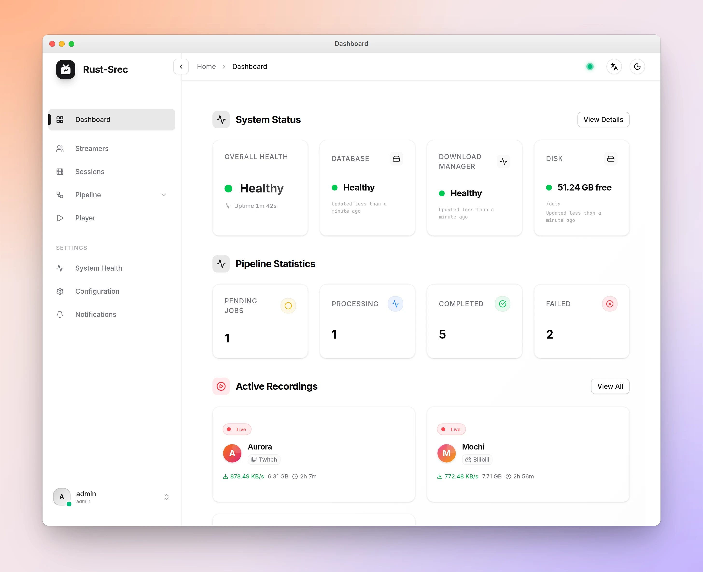
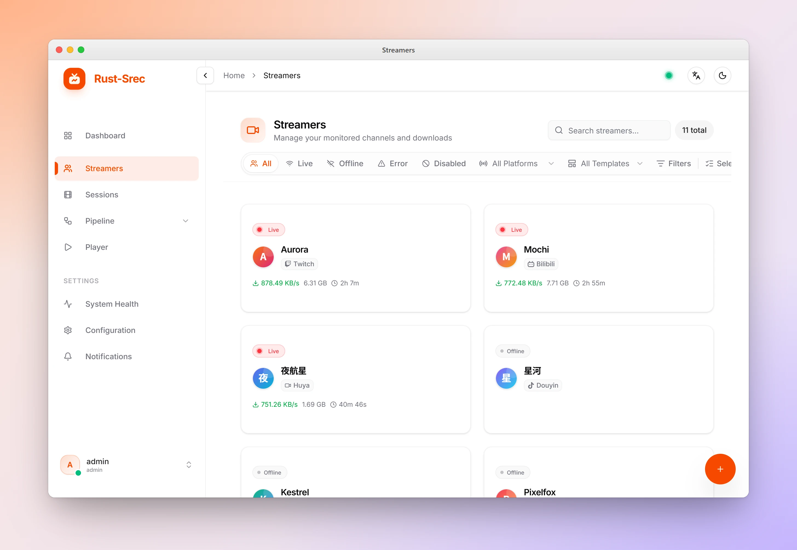
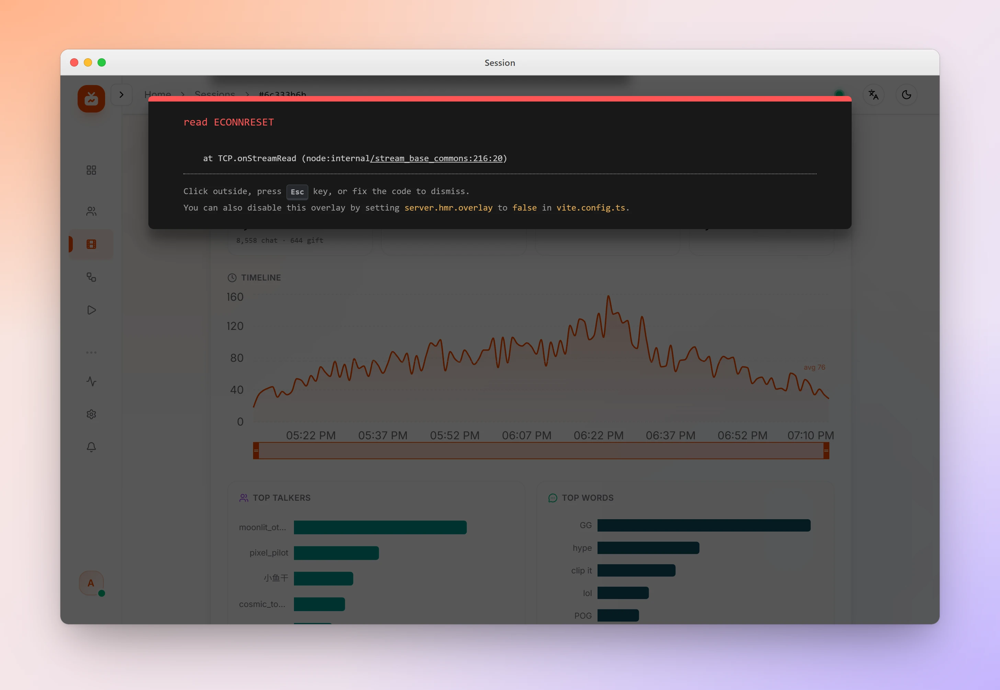
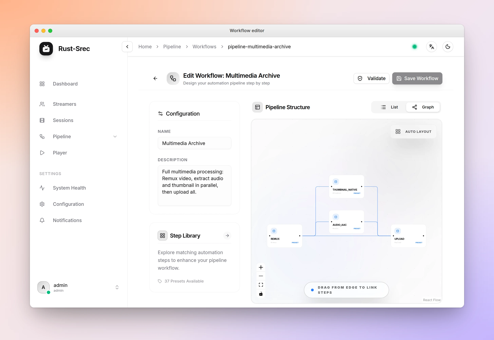
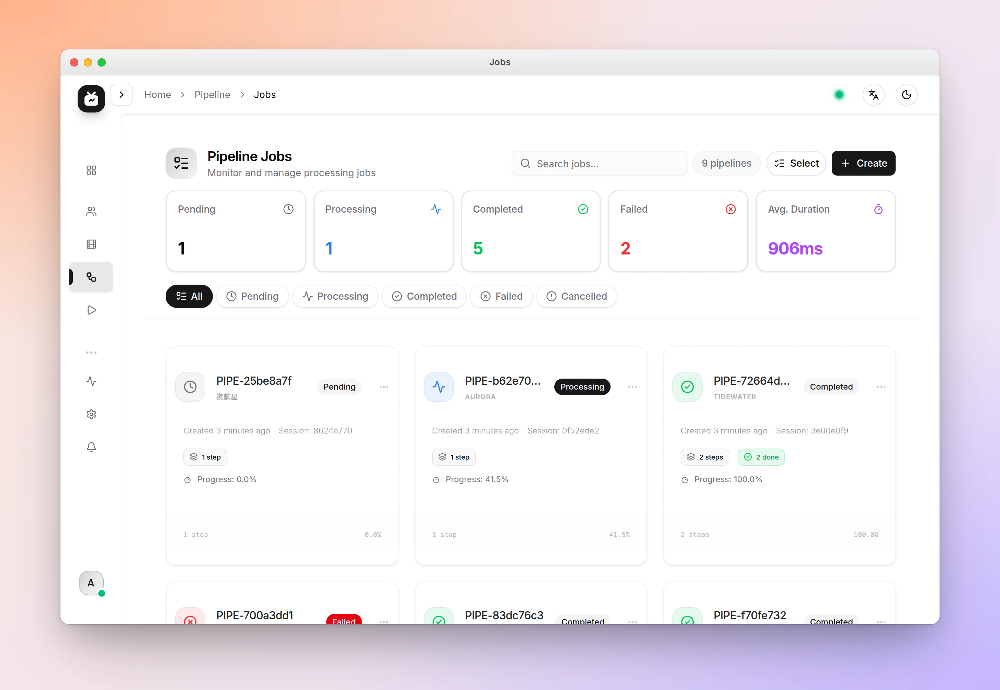

<p align="center">
  
</p>

<h1 align="center">rust-srec</h1>

<p align="center">
  <b>Never miss a stream again.</b><br/>
  rust-srec watches your favorite streamers and starts recording the moment they go live,<br/>
  chat included, on your own computer or server.
</p>

<p align="center">
  <a href="https://github.com/hua0512/rust-srec/releases/latest"></a>
  <a href="https://docs.srec.rs"></a>
  <a href="#license"></a>
</p>

<p align="center">
  <a href="./README.zh-CN.md">简体中文</a> ·
  <a href="https://docs.srec.rs">Documentation</a> ·
  <a href="https://docs.srec.rs/en/getting-started/">Get Started</a> ·
  <a href="https://docs.srec.rs/en/getting-started/faq">FAQ</a> ·
  <a href="https://docs.srec.rs/en/release-notes/">What's New</a>
</p>

<p align="center">
  <picture>
    <source media="(prefers-color-scheme: dark)" srcset="rust-srec/docs/public/images/showcase/en/dashboard-dark.webp" />
    
  </picture>
</p>

---

## Why rust-srec

- 🔴 **Records on its own.** Add a channel once. rust-srec checks it around the clock and starts recording as soon as the stream begins, even at 3 a.m. Set recording hours if you only want certain shows.
- 💬 **Keeps the chat.** On supported platforms, danmaku and live chat are saved next to the video, and every session gets charts of chat activity, top chatters and the most-used words.
- 🩹 **Recordings that actually play.** Streams that stutter, jump or lose their length are repaired while they record, so files open and seek properly in any player.
- ☁️ **Finishes the job for you.** After each stream it can convert the video, make a thumbnail, upload to Google Drive, OneDrive or Baidu Netdisk, and tidy up local copies. You build these steps visually in the workflow editor.
- 🔔 **Tells you what's happening.** Get a message on Telegram, Gotify, email or a webhook when a stream starts, a recording ends or something needs attention.
- 🖥️ **Runs where you want.** Use the desktop app on Windows, macOS or Linux, or run it 24/7 on a home server or NAS with Docker and manage it from any browser.

## Screenshots

<table>
  <tr>
    <td width="50%">

<picture>
  <source media="(prefers-color-scheme: dark)" srcset="rust-srec/docs/public/images/showcase/en/streamers-dark.webp" />
  
</picture>

<p align="center"><sub>Every channel at a glance, live ones with download speed and size</sub></p>

    </td>
    <td width="50%">

<picture>
  <source media="(prefers-color-scheme: dark)" srcset="rust-srec/docs/public/images/showcase/en/danmu-stats-dark.webp" />
  
</picture>

<p align="center"><sub>Chat activity, top chatters and top words for each session</sub></p>

    </td>
  </tr>
  <tr>
    <td width="50%">

<picture>
  <source media="(prefers-color-scheme: dark)" srcset="rust-srec/docs/public/images/showcase/en/workflow-dark.webp" />
  
</picture>

<p align="center"><sub>Build post-processing workflows as a graph</sub></p>

    </td>
    <td width="50%">

<picture>
  <source media="(prefers-color-scheme: dark)" srcset="rust-srec/docs/public/images/showcase/en/jobs-dark.webp" />
  
</picture>

<p align="center"><sub>Follow every processing job as it runs</sub></p>

    </td>
  </tr>
</table>

## Supported platforms

**Bilibili · Douyin · Douyu · Huya · Twitch · TikTok · SOOP · Bigo Live · AcFun · Picarto · Redbook · TwitCasting · Weibo · PandaTV**

Other sites, such as YouTube and Kick, can be recorded through [Streamlink](https://docs.srec.rs/en/platforms/#sites-handled-by-streamlink).

## Get started

### On your computer: the desktop app

Download the installer for Windows (`.msi` / `.exe`), macOS (`.dmg`) or Linux (`.AppImage` / `.deb` / `.rpm`) from the [latest release](https://github.com/hua0512/rust-srec/releases/latest), open it, and add your first streamer. There is nothing to configure.

### On a server or NAS: Docker

One command sets everything up. Linux and macOS:

```bash
curl -fsSL https://docs.srec.rs/install.sh | bash
```

Windows PowerShell:

```powershell
irm https://docs.srec.rs/install.ps1 | iex
```

The installer downloads the files it needs, generates the secrets it needs, and offers to start rust-srec. Then open the web interface in your browser.

> Prefer to read the script before running it, or to set things up by hand? See the [Docker guide](https://docs.srec.rs/en/getting-started/docker). Standalone downloads for every platform are in the [installation guide](https://docs.srec.rs/en/getting-started/installation).

Next, follow [Your first recording](https://docs.srec.rs/en/getting-started/first-recording).

## Learn more

- [Getting started](https://docs.srec.rs/en/getting-started/) – install, add a streamer, find your files
- [Chat recording](https://docs.srec.rs/en/guides/danmu) – what is saved for each platform
- [Recording schedules](https://docs.srec.rs/en/guides/schedules) – record only at certain times
- [Post-processing workflows](https://docs.srec.rs/en/concepts/pipeline) – convert, upload and clean up automatically
- [Notifications](https://docs.srec.rs/en/concepts/notifications) – Telegram, email, webhooks and more
- [FAQ](https://docs.srec.rs/en/getting-started/faq)

## Also in this repository

- **[strev](./strev-cli/README.md)** – look up a live-stream link from the command line and see its qualities and stream addresses.
- **[mesio](./mesio-cli/README.md)** – download and repair live streams from the command line, without the full recorder.

## Contributing

Bug reports, platform fixes and translations are welcome. To build rust-srec or work on the code, start with [CONTRIBUTING.md](./CONTRIBUTING.md).

## License

Licensed under either of the [MIT License](./LICENSE-MIT) or the [Apache License, Version 2.0](./LICENSE-APACHE), at your option. Third-party attributions are in [NOTICE](./NOTICE).
