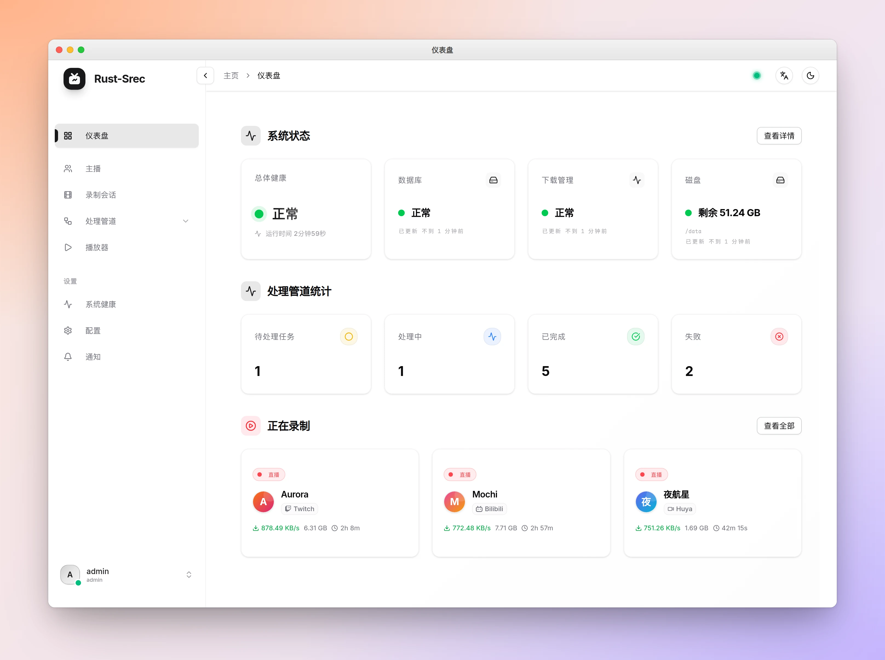
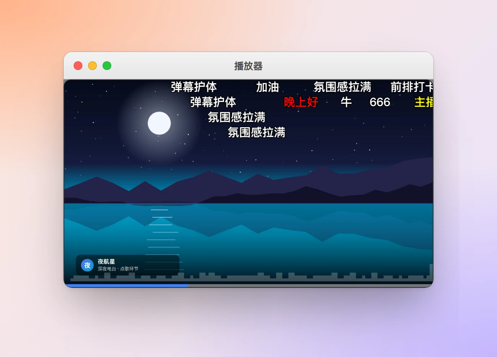
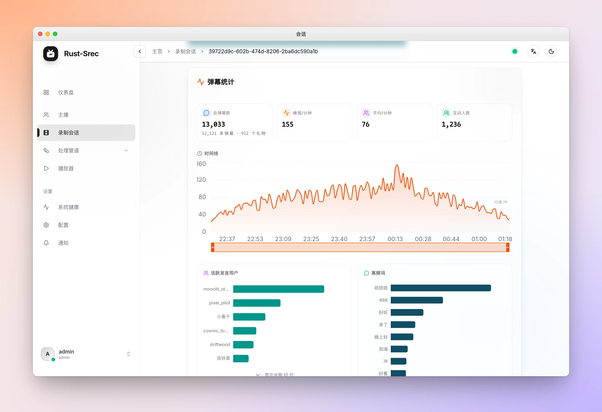
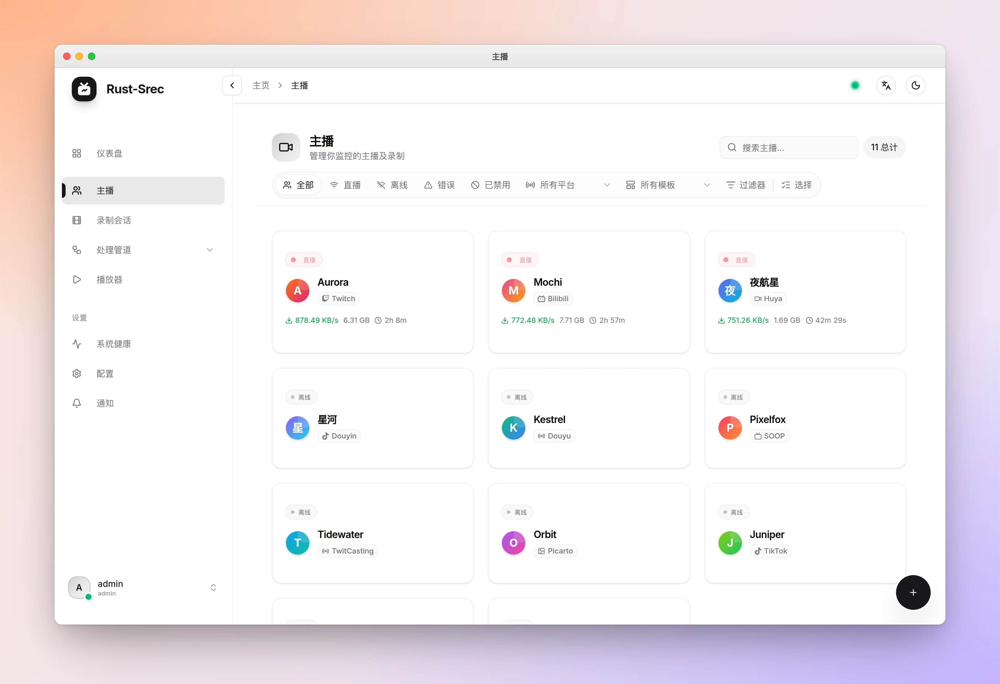
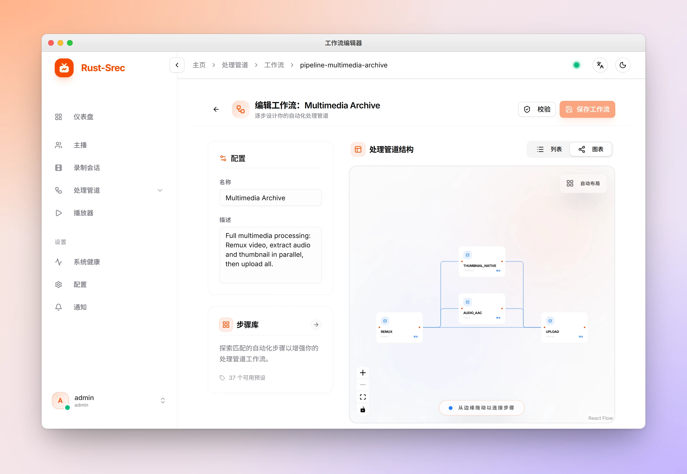
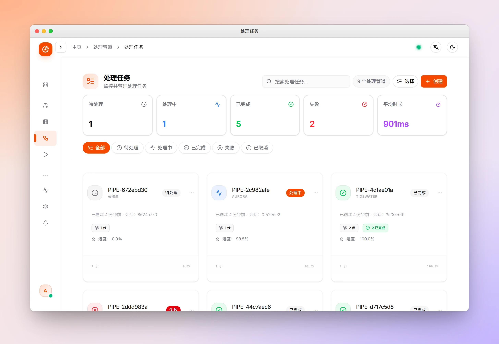
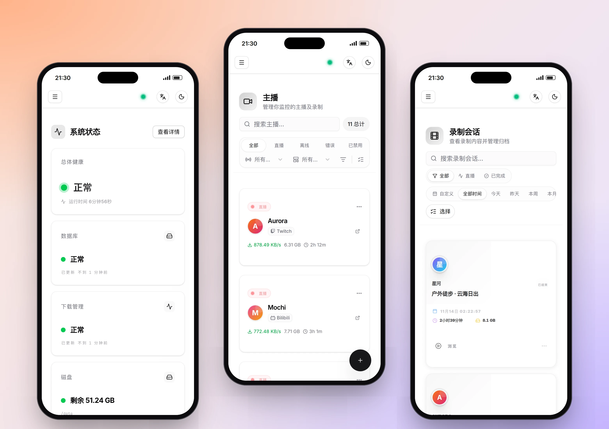

<p align="center">
  
</p>

<h1 align="center">rust-srec</h1>

<p align="center">
  <b>再也不错过任何一场直播。</b><br/>
  rust-srec 帮你盯着关注的主播，一开播就自动录制，弹幕也一并保存，<br/>
  运行在你自己的电脑或服务器上。
</p>

<p align="center">
  <a href="https://github.com/hua0512/rust-srec/releases/latest"></a>
  <a href="https://docs.srec.rs/zh/"></a>
  <a href="#开源协议"></a>
</p>

<p align="center">
  <a href="./README.md">English</a> ·
  <a href="https://docs.srec.rs/zh/">文档</a> ·
  <a href="https://docs.srec.rs/zh/getting-started/">快速上手</a> ·
  <a href="https://docs.srec.rs/zh/getting-started/faq">常见问题</a> ·
  <a href="https://docs.srec.rs/zh/release-notes/">更新日志</a>
</p>

<p align="center">
  <picture>
    <source media="(prefers-color-scheme: dark)" srcset="rust-srec/docs/public/images/showcase/zh-CN/dashboard-dark.webp" />
    
  </picture>
</p>

---

## 为什么选择 rust-srec

- 🔴 **全自动录制**：添加一次主播，rust-srec 全天候帮你守着，一开播立刻开录，凌晨三点也不会错过。只想录特定时段？设置录制时间即可。
- 💬 **弹幕一起留下**：在支持的平台上，弹幕与视频一同保存；每场直播还有弹幕走势、活跃观众和高频词统计。
- 🩹 **录像拿来就能看**：直播流卡顿、跳帧、时长丢失等问题会在录制时自动修复，录出来的文件在任何播放器里都能正常播放和拖动进度。
- ☁️ **录完自动收尾**：每场直播结束后，可以自动转码、生成封面、上传到百度网盘、Google Drive 或 OneDrive，并清理本地文件。这些步骤在工作流编辑器里拖拽即可搭好。
- 🔔 **动态及时通知**：开播、录制结束或需要处理的问题，都能通过 Telegram、Gotify、邮件或 Webhook 通知你。
- 🖥️ **想在哪儿跑就在哪儿跑**：Windows、macOS、Linux 上直接用桌面版；或者用 Docker 部署到家用服务器、NAS 上 7×24 小时运行，在任意浏览器里管理。

## 界面预览

<table>
<tr>
<td width="50%">

<picture>
  <source media="(prefers-color-scheme: dark)" srcset="rust-srec/docs/public/images/showcase/zh-CN/player-dark.webp" />
  
</picture>

<p align="center"><sub>回放录像，弹幕同步叠加在画面上</sub></p>

</td>
<td width="50%">

<picture>
  <source media="(prefers-color-scheme: dark)" srcset="rust-srec/docs/public/images/showcase/zh-CN/danmu-stats-dark.webp" />
  
</picture>

<p align="center"><sub>每场直播的弹幕走势、活跃观众与高频词</sub></p>

</td>
</tr>
<tr>
<td width="50%">

<picture>
  <source media="(prefers-color-scheme: dark)" srcset="rust-srec/docs/public/images/showcase/zh-CN/streamers-dark.webp" />
  
</picture>

<p align="center"><sub>所有频道一览，直播中的会显示下载速度和文件大小</sub></p>

</td>
<td width="50%">

<picture>
  <source media="(prefers-color-scheme: dark)" srcset="rust-srec/docs/public/images/showcase/zh-CN/workflow-dark.webp" />
  
</picture>

<p align="center"><sub>以图的方式编排后处理工作流</sub></p>

</td>
</tr>
<tr>
<td width="50%">

<picture>
  <source media="(prefers-color-scheme: dark)" srcset="rust-srec/docs/public/images/showcase/zh-CN/jobs-dark.webp" />
  
</picture>

<p align="center"><sub>实时查看每个处理任务的进度</sub></p>

</td>
<td width="50%">

<picture>
  <source media="(prefers-color-scheme: dark)" srcset="rust-srec/docs/public/images/showcase/zh-CN/mobile-dark.webp" />
  
</picture>

<p align="center"><sub>在手机上随时查看录制情况</sub></p>

</td>
</tr>
</table>

## 支持平台

**Bilibili · 抖音 · 斗鱼 · 虎牙 · Twitch · TikTok · SOOP · Bigo Live · AcFun · Picarto · 小红书 · TwitCasting · 微博 · PandaTV**

YouTube、Kick 等其他网站可以通过 [Streamlink](https://docs.srec.rs/zh/platforms/#sites-handled-by-streamlink) 录制。

## 开始使用

### 在自己的电脑上：桌面版

从[最新版本](https://github.com/hua0512/rust-srec/releases/latest)下载对应系统的安装包：Windows（`.msi` / `.exe`）、macOS（`.dmg`）或 Linux（`.AppImage` / `.deb` / `.rpm`），打开后添加第一个主播即可，无需任何配置。

### 在服务器或 NAS 上：Docker

一行命令完成部署。Linux 与 macOS：

```bash
curl -fsSL https://docs.srec.rs/install.sh | SREC_LANG=zh bash
```

Windows PowerShell：

```powershell
$env:SREC_LANG = "zh"; irm https://docs.srec.rs/install.ps1 | iex
```

安装脚本会下载所需文件、生成所需密钥，并询问是否立即启动。启动后在浏览器中打开 Web 界面即可。

> 想先审阅脚本内容，或者手动部署？请参考 [Docker 部署文档](https://docs.srec.rs/zh/getting-started/docker)。各平台的独立程序下载见[安装指南](https://docs.srec.rs/zh/getting-started/installation)。

接下来，跟着[第一次录制](https://docs.srec.rs/zh/getting-started/first-recording)走一遍吧。

## 了解更多

- [快速上手](https://docs.srec.rs/zh/getting-started/)：安装、添加主播、找到录像文件
- [弹幕录制](https://docs.srec.rs/zh/guides/danmu)：各平台会保存哪些内容
- [录制计划](https://docs.srec.rs/zh/guides/schedules)：只在指定时间段录制
- [后处理工作流](https://docs.srec.rs/zh/concepts/pipeline)：自动转码、上传和清理
- [通知](https://docs.srec.rs/zh/concepts/notifications)：Telegram、邮件、Webhook 等
- [常见问题](https://docs.srec.rs/zh/getting-started/faq)

## 仓库中的其他工具

- **[strev](./strev-cli/README.md)**：在命令行中解析直播链接，查看可用清晰度和直播流地址。
- **[mesio](./mesio-cli/README.md)**：在命令行中下载并修复直播流，无需运行完整的录制服务。

## 参与贡献

欢迎反馈问题、修复平台解析或改进翻译。想自行编译或参与开发，请先阅读 [CONTRIBUTING.md](./CONTRIBUTING.md)。

## 开源协议

可任选 [MIT 协议](./LICENSE-MIT) 或 [Apache 2.0 协议](./LICENSE-APACHE) 使用。第三方署名见 [NOTICE](./NOTICE)。
