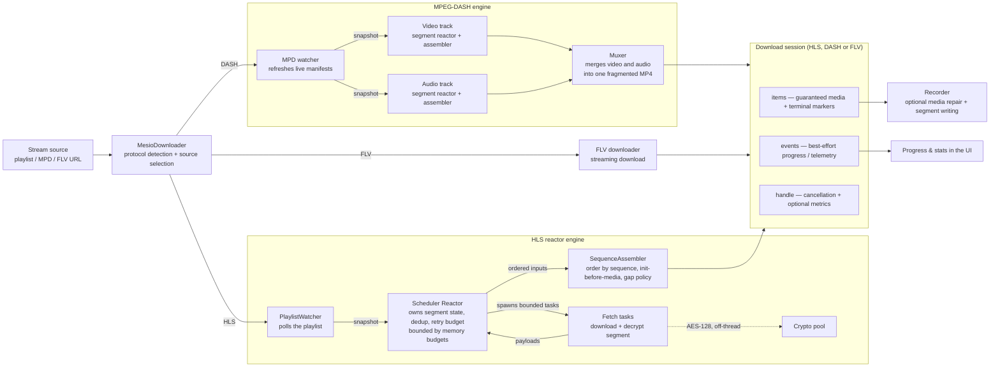

# Mesio Engine

Mesio is rust-srec's **in-process Rust download engine**. Unlike `FFMPEG` and `Streamlink`, it is not an external program — it runs inside the recorder, which is why it has the lowest CPU and memory footprint of the three engines and supports multithreaded HLS and MPEG-DASH downloads. This page covers Mesio's implementation; for a side-by-side comparison of all three engines and their features, see [Engines](./engines.md).

## Architecture

A single `MesioDownloader` picks the protocol (HLS, MPEG-DASH or FLV) and the source, then produces one **download session** regardless of protocol. The session exposes two streams — a guaranteed **items** stream of media data and terminal markers, and a best-effort **events** stream of progress/telemetry — plus a control handle for cancellation and optional metrics.

## HLS reactor engine

For HLS, all download state lives in one place — the **Scheduler Reactor**. It owns:

- **Segment identity and de-duplication**, so segments are not re-fetched when a playlist refresh rotates auth tokens (for example Twitch signed URLs, where the rotating query parameters can be stripped so the same segment is recognized across refreshes).
- **The retry budget**, including transparently retrying a signed URL that expires mid-download against a newer one.
- **Bounded concurrent fetch tasks**, whose in-flight downloads, decryption work, and output buffers are each capped by explicit memory budgets — so a fast or encrypted stream can no longer grow memory without limit.

Decryption runs on a separate **crypto pool**, off the scheduling loop, so decryption does not block scheduling when many encrypted segments arrive at once. The **SequenceAssembler** then guarantees ordered output, writes fMP4 init segments before the media that depends on them (avoiding codec-mismatch corruption), and emits explicit gaps instead of silently stalling when segments drop out of the live window.

### Rate limiting {#rate-limiting}

When a server answers HLS or DASH requests with HTTP 429 (Too Many Requests), or 503 with a `Retry-After` header, Mesio pauses every request to that server for as long as `Retry-After` asks, from a quarter of a second up to one minute, or else for a backoff that starts at about one second and doubles up to 30 seconds while the server keeps refusing. The pause applies to the server that answered, also when a request was redirected there, and redirects into a paused server wait too. When the pause ends, one request goes first; the others follow once it is answered, so the server does not receive the whole backlog at once.

These answers do not use up the segment or playlist/manifest retry counts. A segment is given up five minutes after it was first held back, and a live segment that leaves the playlist window meanwhile is skipped as a gap. If a segment address that carries a signature is refused as unauthorized right after such a pause, Mesio waits up to 10 seconds for the next playlist or manifest to bring a fresh address before giving the segment up. The recording fails when the playlist or manifest has not been fetched for five minutes because of rate limiting, or sooner when no media at all arrives for the **Max Stall Duration**, as happens while an HLS playlist is refused.

## MPEG-DASH engine {#mpeg-dash-engine}

Mesio records MPEG-DASH (`.mpd`) streams, both live and finished (on-demand) presentations. Streams that a platform labels as DASH, and addresses ending in `.mpd`, use this engine.

- An **MPD watcher** loads the manifest and, for live streams, refreshes it no more often than the configured minimum interval or the manifest's own update period. It corrects for a difference between the local clock and the server's, so live segments are not requested before they exist. When a finished presentation stores each version as one file with an index (`SegmentBase`), the watcher reads the index of the versions to be recorded before recording starts, so their segments can be downloaded piece by piece.
- One video and one audio track are selected according to the configured quality and audio language. Each track is downloaded by the same reactor and assembler as HLS, with its own memory budget, so a slow track cannot stall the other.
- A **muxer** merges the separately delivered video and audio into **one fragmented MP4 file**. The recording is then repaired, split, and written like an HLS fMP4 recording; **Fix DASH Streams** (`fix_dash`) turns that repair on or off.

A recording starts a new file when the presentation moves to a new Period (for example around an inserted ad) or the selected video or audio version changes. A finished presentation is recorded from its first segment and ends the recording when its last segment is written. A live recording starts behind the live edge according to the [live start setting](./engines.md#mpeg-dash).

Limitations:

- DRM-protected (encrypted) streams and WebM media are refused. Manifests using `SegmentTemplate` or `SegmentList` are supported, and so are finished presentations using `SegmentBase`; a live manifest using `SegmentBase` is refused.
- Subtitles and other text tracks are not recorded.
- Tracks are chosen from the Period where recording starts: a track kind that only appears in a later Period is not added.
- The web player cannot play DASH streams; it reports the format as unsupported. Recorded files are ordinary MP4 files.

DASH settings are listed under [MPEG-DASH recording](./engines.md#mpeg-dash).

## Download sessions

Mesio's HLS, DASH and FLV downloaders share this single session model, so progress reporting, retry handling, and cancellation behave consistently across protocols. The **items** stream is authoritative — it carries the media and terminal markers the recorder relies on — while the **events** stream is best-effort telemetry used to render progress and statistics in the UI. The **handle** carries cancellation and the optional performance metrics.

## Media-fix pipelines

The download session and media repair are separate layers. When stream processing and the matching Mesio fix setting are enabled, downloaded items are repaired before they reach the writer. Otherwise, they go directly to the writer.

- **FLV repair** fixes missing container structure and timestamp discontinuities, filters configured duplicates, starts a new output file when stream headers become incompatible, and maintains seek metadata. Processing buffers are bounded so malformed or unusual streams cannot grow them indefinitely.
- **HLS and DASH repair** preserves fragmented-MP4 initialization order, checks delivered TS and fMP4 segments for incompatible format changes, starts a new output file when needed, and enforces file-size or duration limits. Memory use is bounded by data size rather than only by the number of queued segments.

The HLS download reactor reports or skips unavailable media according to the configured gap policy. The fix pipeline receives only delivered media and explicit split or terminal markers; it cannot reconstruct bytes that the source never delivered and it does not transcode media payloads.

A download that delivers no media because its segments failed ends with that failure, such as the HTTP status or network error, rather than as an empty recording. Once media is known to need an fMP4 initialization segment that failed, it is no longer downloaded, since it cannot be decoded; a live stream that would start with such media ends at once. MPEG-TS media is still downloaded, because it decodes without its initialization segment.

## Mesio-exclusive features

Mesio-specific processing options are documented on the [Engines](./engines.md) page:

- [FLV Consistency Fix](./engines.md#_2-flv-consistency-fix) — repair FLV structure and timing, and finalize AMF metadata without moving the file tail.
- [Raw Data Mode](./engines.md#_3-raw-data-mode) — write stream bytes directly to disk without packet parsing to reduce CPU and memory use.
- [HLS Consistency Fix](./engines.md#_4-hls-consistency-fix-mesio-exclusive) — guard segment structure and rotate output at discontinuities or meaningful stream changes before writing.
- [MPEG-DASH recording](./engines.md#mpeg-dash) — record DASH streams with separately delivered video and audio merged into one file.

> [!NOTE]
> The full engine design lives alongside the source at [`crates/mesio/docs/HLS_ENGINE_ARCHITECTURE.md`](https://github.com/hua0512/rust-srec/blob/main/crates/mesio/docs/HLS_ENGINE_ARCHITECTURE.md) and [`crates/mesio/docs/DOWNLOADER_ENGINE_ARCHITECTURE_PLAN.md`](https://github.com/hua0512/rust-srec/blob/main/crates/mesio/docs/DOWNLOADER_ENGINE_ARCHITECTURE_PLAN.md).
