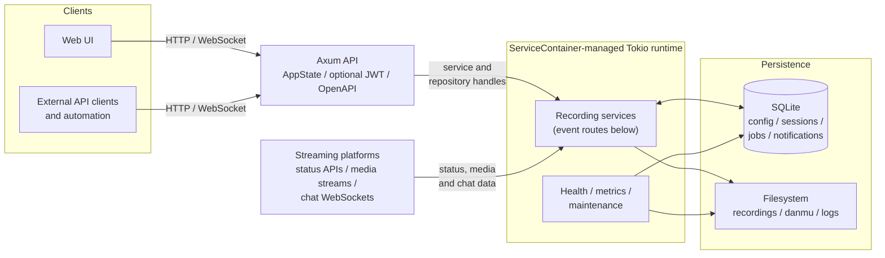
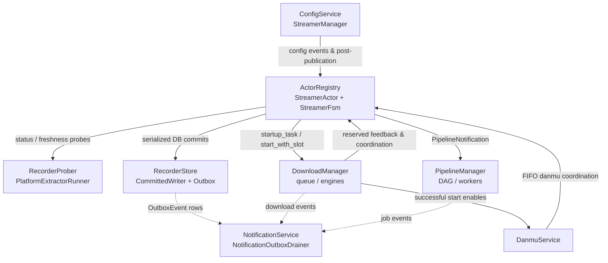
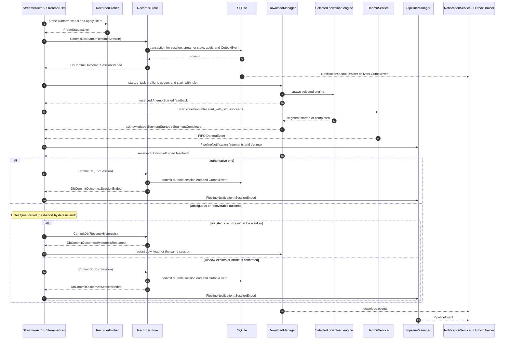
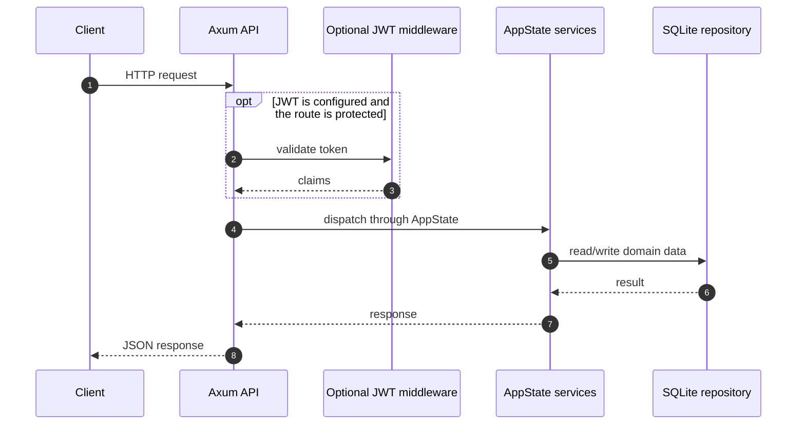

# Runtime architecture

For contributors changing backend services. For the recording process and deployment boundaries, see the [system overview](../concepts/architecture.md).

## High-level topology {#high-level-topology}



Inside the runtime, the workspace is split into a unidirectional crate DAG composed by the thin `rust-srec` root package:

- **Layer 0 (`srec-core`, `srec-sqlite`)**: storage-free domain types, ports, and utilities; SQLite pools, `CommittedWriter`, base models/repositories, and migrations.
- **Layer 1 (`srec-engines`, `srec-processors`, `srec-notify`)**: download engines (`ffmpeg`, `streamlink`, `mesio`) and danmu runner; post-processing operators and BaiduPCS-Go; notification channels, Web Push, backend locales, and `NotificationOutboxDrainer`.
- **Layer 2 (`srec-pipeline`, `srec-recorder`)**: post-processing `PipelineManager` / `DagScheduler` / worker pools; recording control plane (`ActorRegistry`, `StreamerActor`, `StreamerFsm`, `RecorderProber`, `RecorderStore`), `DownloadManager`, `DanmuService`, `ConfigService`, `StreamerManager`, credentials, and proxies.
- **Layer 3 (`srec-api`)**: Axum REST/WebSocket routes, Protobuf, OpenAPI, MCP server, auth store, CQRS queries, dynamic logging, and health metrics.
- **Layer 4 (`rust-srec`)**: `ServiceContainer` wiring, `ConfigBackupPort` export/import, `MaintenanceScheduler`, startup migrations, process supervision, and the `backend` facade used by the standalone binary and `src-tauri`.

Inside the recording runtime, services pass events along these routes:



Arrows between runtime services show logical control and event routes. `ServiceContainer` wires the services with broadcast subscriptions, reserved feedback permits, acknowledged coordination channels, and post-publication listeners rather than direct circular coupling.

Three ownership boundaries are important in this topology:

- `ServiceContainer` is the composition root and event-wiring layer, not the owner of domain state.
- `StreamerFsm` is a pure synchronous state machine driven by one `StreamerActor` per active streamer under `ActorRegistry`. `RecorderProber` performs status/freshness extraction, and `RecorderStore` serializes durable SQLite commits and `OutboxEvent` persistence.
- A live commit starts the download path first through `startup_task` and `StartupLeaseRegistry`. Danmu collection starts only after `DownloadManager::start_with_slot` returns a real download ID.

## Runtime root: `ServiceContainer` {#runtime-root-servicecontainer}

The `ServiceContainer` (in `rust-srec/src/services/container.rs`) initializes and connects the runtime services:

- Initializes repositories and services (DB, config cache, managers)
- Starts background tasks (`ActorRegistry`, `NotificationOutboxDrainer`, pipeline workers, maintenance, and Bigo live notifications)
- Subscribes to event streams and forwards events between services
- Owns the `CancellationToken` used for graceful shutdown

It manages service lifecycle, dependencies, and shutdown order.

## Service Container Responsibilities {#service-container-responsibilities}

Container assembly, ordered shutdown, output-root helpers and event decisions live in separate private modules. Initialization discovers output roots once and shares that snapshot between health registration and startup write probes.

Startup logs time database/configuration I/O, engine discovery, awaited initialization phases and the overall startup. Synchronous wrapper construction and background-task spawning are not timed individually, because that would not measure the work the tasks perform later.

## Core components (what each one actually does) {#core-components-what-each-one-actually-does}

### Recording startup and cancellation (`startup_task` / `StartupLeaseRegistry`) {#recording-startup-and-cancellation}

Download startup and danmu setup are bound to the session and attempt that initiated them through
`StartupLeaseRegistry` (`srec-recorder/src/recorder/actor/startup_task.rs`). An offline decision
for an older session stops only that session's attempt; it cannot select a successor by streamer ID.
Disable, out-of-schedule, credential-retirement, and deletion stops also cancel startup leases that
have registered before entering the download queue.

Startup observes cancellation during configuration lookup, preflight, queue acquisition, freshness
checks, credential-binding validation, and final admission. Cancelled work releases its lease and
does not start danmu. Once a danmu collector is started, shutdown and retirement wait for confirmed
cleanup rather than abandoning the collection task. Queue waits strictly greater than the freshness
threshold re-probe URLs, headers, and extras together; missing or offline results dequeue, while
transient probe errors fall back to the cached media payload.

### `ConfigService` (configuration + hot reload) {#configservice-configuration-hot-reload}

`ConfigService` is the configuration control plane. It loads and merges a 4-level hierarchy:

1. Global defaults
2. Platform configuration
3. Template configuration
4. Streamer-specific overrides

It also caches merged results and broadcasts `ConfigUpdateEvent` so runtime services can respond to
changes without a restart.

Each layer's proxy route is resolved with the rest into `MergedConfig.proxy_route`, which checks,
downloads, danmu and server-proxied playback share; saved proxies themselves are written through
`ProxyService`. See [Proxy routes](./configuration.md#proxy-routes).

See also: [Configuration](../concepts/configuration.md)

### `StreamerManager` (committed metadata snapshots) {#streamermanager-committed-metadata-snapshots}

SQLite rows are authoritative. `StreamerManager` exposes immutable shared metadata snapshots
for actor checks and cloned values for administrative consumers. Runtime writers share a
`CommittedStreamerState` owner: it retains the validated single-writer connection through a
borrowed immediate transaction, commit, and synchronous metadata/URL-index publication.
No awaited runtime effect holds that database lease.

Cancellation before commit rolls back the prepared mutation. Once commit begins, supervised
completion applies the committed snapshot even if the requesting task disappears. State,
session and outbox changes stay atomic; `RETURNING` supplies the committed streamer fields
without a post-commit read. Current runtime-only offline-check settings survive publication.
Admin patches read the current database row, so unrelated credentials/counters are retained,
and failed URL edits change neither cache index. Merged configuration invalidation shares a
short mutation boundary with in-flight completion, so an older load cannot repopulate
credentials after a newer committed write invalidates them.

Imports publish their row snapshots silently and invalidate filter snapshots at commit. Their
ordered credential, retirement, metadata, channel and global notifications then finish under
the same task owner after releasing the writer, with one import admission permit bounding
that runtime work. Post-commit reload failures remain warnings about committed changes.

Important correctness detail: on startup it performs **restart recovery** by resetting any streamers
left in `Live` back to `NotLive`, so the normal `NotLive → Live` edge can trigger downloads again.
The actor also applies its first confirmed offline observation even when both states are
`NotLive`, closing an unfinished database session and publishing its final completion. Failed or
suppressed application remains pending for another check. A live observation reuses the unfinished
session, preserving recording continuity across a restart.

### `ActorRegistry` and `StreamerActor` (control-plane orchestration) {#recorder-control-plane}

`ActorRegistry` (`srec-recorder/src/recorder/registry.rs`) supervises resident per-streamer actors:

- `StreamerActor`: one non-blocking `tokio::select!` loop per active streamer driving a `StreamerFsm`, polling its mailbox, at most one in-flight `CommitDb` future, at most one in-flight `Probe` future, an optional batch-precheck live hint, its next FSM deadline timer, and side-effect tasks.
- `ActorRegistry`: reconciles active streamers from `PostPublicationListener` batches and `ConfigUpdateEvent`s, tracks actor generations and monotonic config revisions, bridges download/danmu coordination into actors, enforces 4-owner physical retirement (`retire_streamer` / `retire_and_reap`), and supervises panicking actors.

Before spawning an actor or pushing updated configuration, `ActorRegistry` resolves the
Global → Platform → Template → Streamer hierarchy through `ConfigService` and allocates a monotonic
config revision before awaiting resolution so slower lookups cannot overwrite newer updates.
If a lookup fails, a running actor keeps its last good configuration, no actor starts, and the
lookup is retried with exponential backoff (5 s base, 5 min cap).
Configuration updates never force a check; only credential, filter and error-clear events request one.
Recurring checks sample an interval within ±10% of the configured cadence. An unchanged effective
interval preserves the pending deadline; a changed interval can bring it forward without postponing
an already scheduled check. Smart-wake hints, admission/cooldown deadlines, explicit immediate checks,
and live watchdog states keep their own timing.

Expected terminal stops (`Disabled`, `FatalError`, `Retired`, `Shutdown`) clear credential blocks
and exit without restart. If an actor task panics, `ActorRegistry` schedules supervised restarts
with exponential backoff (2 s base, 60 s cap) up to `MAX_CRASH_RESTARTS` (5) attempts; a clean exit
clears the crash counter.

### `RecorderProber` and `RecorderStore` (probing, persistence, and outbox) {#recorder-prober-and-store}

- **`RecorderProber`** (`srec-recorder/src/recorder/prober.rs`) wraps the shared
  `PlatformExtractorRunner` (pooled HTTP clients and proxy/tunnel `ExtractorFactory`), deduplicates
  in-flight probes by `CredentialCheckKey`, runs optional batch precheck and Bigo live-notification
  gating, tracks credential blocks, persists platform metadata via CAS, and records check history
  non-blockingly.
- **`RecorderStore`** (`srec-recorder/src/recorder/store.rs`) executes every `DbCommitOp`
  (`StartOrResumeSession`, `ResumeHysteresis`, `EndSession`, `RecordFatalError`,
  `RecordTransientError`, `SetInfraBlocked`, etc.) under a per-streamer serialization lease and
  `CommittedWriter` (`committed_write_supervisor`). Sealed commits finish even if the actor stops
  or is dropped, synchronously publish committed rows to `StreamerCache`, release the SQLite write
  connection and streamer lease, and then notify `NotificationOutboxDrainer` and
  `PostPublicationListener`.

**Outbox pattern:** User-facing notification records (`OutboxEvent` in `srec-core`) are written to
`monitor_event_outbox` in the same SQLite transaction as state/session updates. `NotificationOutboxDrainer`
(in `srec-notify`) scans undelivered rows in ascending `id` order, decodes both current `OutboxEvent`
records and pre-v2 `LegacyOutboxEvent` rows left behind across upgrades, and marks `delivered_at`
only after `NotificationService::deliver_durable_for_outbox` settles.

### `StreamerFsm` (single owner of session and monitoring state) {#streamerfsm-state-machine}

`StreamerFsm` (`srec-recorder/src/recorder/fsm.rs`) is a pure synchronous state machine that owns
monitoring cadence, offline confirmation, quiet-period hysteresis, terminal-cause classification,
credential diagnostic recovery, and stop coordination for one streamer.

Fresh starts (`CommittingStart`) and durable ends commit their SQLite mutations through
`RecorderStore` before starting downloads or emitting `PipelineNotification::SessionEnded`.
Quiet-period entry keeps the SQLite session open (`end_time IS NULL`) while writing a best-effort
hysteresis audit row; live probes within the window commit `ResumeHysteresis` and restart recording
on the same session, whereas backstop expiry or confirmed offline commits `EndSession`. If a
quiet-period expiry commit fails transiently, the FSM retains the open session and retries on a
1-second timer. Graceful shutdown drains in-flight commits and actors; forced shutdown respects the
hard deadline without aborting a sealed `COMMIT`.

### `DownloadManager` (downloads + engine abstraction) {#downloadmanager-downloads-engine-abstraction}

The download manager owns:

- Concurrency limits (including extra slots for high priority downloads)
- Failure classification and circuit breakers keyed by engine type, configuration, and optional
  streamer scope
- Failure/rejection events and retry-after hints; `StreamerFsm` decides when to check again and
  re-enter the download-start path
- Engine abstraction:
  - External processes: `ffmpeg`, `streamlink`
  - In-process Rust engine: `mesio`

It emits `DownloadManagerEvent` for lifecycle, segment boundaries, and (optionally) progress.

For persisted session segments, the backend keeps three separate timestamps:

- `created_at`: when the segment started recording
- `completed_at`: when the segment finished recording
- `persisted_at`: when the segment metadata row was stored in SQLite

### `DanmuService` (chat capture) {#danmuservice-chat-capture}

Danmu collection is session-scoped but writes files per segment:

- A websocket connection stays alive for the session
- Segment boundaries (from download events) open/close danmu files (e.g. XML)
- Danmu events are forwarded to the pipeline for paired/session coordination

### `PipelineManager` (job queue + DAG + worker pools) {#pipelinemanager-job-queue-dag-worker-pools}

The pipeline manager is the post-processing engine:

- Maintains a DB-backed job queue (with recovery on restart)
- Executes a DAG pipeline model (fan-in / fan-out)
- Uses separate worker pools for CPU-bound processors, IO-bound processors and uploads; the upload pool is sized by **Max Uploads** and runs at most one BaiduPCS upload at a time
- Coordinates multi-stage triggers:
  - Segment pipelines (single output file)
  - Paired-segment pipelines (video + danmu for the same segment index)
  - Session-complete pipelines (once all segments are complete)

See also: [DAG Pipeline](../concepts/pipeline.md)

### `NotificationService` (event fan-out) {#notificationservice-event-fan-out}

Notifications subscribe to monitor/download/session/pipeline events and deliver them to configured
channels (Discord / Email / Gotify / Telegram / Webhook), with retry, circuit breakers, and
dead-letter persistence. Optional browser Web Push delivery is handled by `WebPushService`.

See also: [Notifications](../concepts/notifications.md)

### Repository row writes {#repository-row-writes}

Complete job, DAG, step, session, media-output and segment writes share repository-owned
column bindings on an existing SQLite connection. Callers retain retry, clock and transaction
ownership. DAG publication inserts unattached steps before atomically attaching root jobs;
later materialization keeps its separate active-parent and PENDING/BLOCKED guards.

Raw session creation preserves the supplied model, while lifecycle creation builds an active
session with its initial title. Raw ending remains unconditional; lifecycle ending only changes
an active row. Media insertion and session-size accounting commit together, and combined segment
creation joins that transaction. Standalone segment insertion does not add to the session total.
Stored millisecond values, nullable lifecycle timestamps and omitted schema defaults are preserved.

## Downloader Rust Interfaces {#downloader-rust-interfaces}

The download manager keeps event contracts in `downloader::manager::events`, acknowledged delivery in `coordination`, engine configuration in `configuration`, and attempt ownership in `attempt`. These implementation modules remain private; public event imports through `downloader` and internal imports through `downloader::manager` are preserved. Runtime shutdown uses `DownloadManager::shutdown_until`, and the active entry retains its queue slot until removal.

Rust integrations should use the supported manager shutdown and snapshot methods, `DownloadConfig::build_pipeline_config`, and the public `CircuitBreaker` methods. Internal breaker ownership uses `CircuitBreakerManager::get`. Mesio engine diagnostics report the linked crate's `mesio::VERSION`.

### FFmpeg recording events {#ffmpeg-recording-events}

Direct FFmpeg and Streamlink remuxing share segment identity, duration/byte totals,
progress sampling, output-error classification and final event publication. The
filesystem byte cache belongs to one segment: after rotation, parsed progress is
used until that segment has a successful metadata sample. Filesystem sampling
remains throttled to 500 ms per active segment.

Stderr EOF does not prove the final file is closed. The tracker waits for the
process owner's exit result before inspecting and publishing the final segment;
unconfirmed cleanup suppresses that completion. Output-I/O errors remain ordered
before terminal failure, and exit 228 supplies a disk-full fallback only when
stderr has not already identified the output error.

Auxiliary settlement retains completed task results across timeout, aborts and
joins unfinished tasks after unconfirmed cleanup, and lets confirmed cleanup
finish its final events. FFmpeg's stdin stop command and Streamlink's producer,
pipe and contained-child shutdown policies remain separate. Streamlink gets a
bounded exit wait before contained termination, within the attempt's remaining
process budget; see [Streamlink stopping](../concepts/engines.md#stopping-streamlink-recordings).

## Key flows {#key-flows}

### Recording lifecycle (end-to-end) {#recording-lifecycle-end-to-end}



### API request flow (control plane) {#api-request-flow-control-plane}



Protected routes use JWT middleware unless authentication is disabled with `AUTH_DISABLED`, in
which case every route is unauthenticated. The full health and readiness handlers validate bearer
tokens themselves; liveness and idle checks are public. WebSocket, media, and stream-proxy routes use their documented
query-parameter authentication paths.

## Recorder state and backoff {#scheduler-state-and-backoff}

Streamer actors keep scheduling state in `StreamerFsm` and read immutable snapshots from `StreamerManager`'s database-backed cache. Runtime recovery relies on SQLite sessions and streamer state; no actor state files are required.

Monitoring uses transactional error writes in `RecorderStore` and `disabled_until_for_error_count`. Backoff preserves the configured threshold, starts at 60 seconds, doubles, and caps at one hour; very large stored error counts reach that cap without overflowing. Database/cache publication shares the `CommittedWriter` boundary described above.

### Reliable lifecycle feedback {#reliable-lifecycle-feedback}

Recording startup and terminal feedback use a reserved-capacity lane (`RecorderDownloadFeedback` implemented by `ActorRegistry::download_feedback`), separate from progress broadcasts and segment coordination acknowledgements. `ServiceContainer` wires it via `DownloadManager::set_recorder_feedback` during construction. Each admitted attempt reserves capacity for `AttemptStarted` and `DownloadEnded` before starting. Admission never waits for the actor to process its mailbox; terminal feedback is published strictly after the download slot is released. Actor generations and attempt IDs fence delayed messages.

The lane retains at most 32 lifecycle permits per streamer. Its global budget is 1,024 backlog permits plus twice the highest configured total recording concurrency, including high-priority extra slots. Increases grow that budget; decreases preserve outstanding reservations. Full admission returns the retryable `RecorderFeedbackBusy` error (HTTP error code `SCHEDULER_FEEDBACK_BUSY`) and notifies `ActorRegistry::request_retry_admission` without marking the streamer offline or disabled.

Configuration resolution allocates a monotonic revision before awaiting `ConfigService`, so slower lookups cannot overwrite newer updates, and lagged configuration broadcasts trigger full reconciliation. Progress remains lossy and throttled. Shutdown stops monitoring before draining recordings, and trailing closed segments still persist through `ActorRegistry`'s session-level fallback after an actor exits.

## Event-driven communication {#event-driven-communication}

Cross-service coordination uses explicit lanes matching delivery guarantees:

| Stream / lane | Publisher | Typical consumers | Notes |
|---|---|---|---|
| `ConfigUpdateEvent` | `ConfigService`, `StreamerManager` | `ActorRegistry`, `ServiceContainer` | Drives actor reconciliation, runtime reconfiguration, and cleanup |
| `PostPublicationChangeSet` | `CommittedStreamerState`, `RecorderStore` | `ActorRegistry` | Fires strictly after `COMMIT` and lock release to reconcile actors |
| `OutboxEvent` (SQLite outbox) | `RecorderStore` | `NotificationOutboxDrainer` → `NotificationService` | Persisted atomically with state/session commits; survives restarts |
| `DownloadManagerEvent` | `DownloadManager` | `ActorRegistry` (reserved feedback + coordination + progress), `NotificationService` | Reserved permits for `Started`/terminal; acknowledged coordination for segments |
| `DanmuEvent` | `DanmuService` | `ActorRegistry` (FIFO coordination) | Delivered in order to actors (with post-exit fallback) and forwarded to `PipelineManager` |
| `PipelineNotification` | `StreamerActor` / `ActorRegistry` | `PipelineManager` (via `RecorderPipelinePort`) | Drives segment, paired-segment, and session-complete DAG triggers |
| `PipelineEvent` | `PipelineManager` | `NotificationService` | Job lifecycle events for observability |

::: tip About throttling
`PipelineManager` contains an optional throttling subsystem (`ThrottleController`) that can emit
events and apply download concurrency adjustments if a `DownloadLimitAdjuster` is wired in.
:::

### Output-root write gate {#output-root-write-gate}

The download manager runs an **output-root write gate** (in `downloader::output_root_gate`) that operates at the filesystem boundary, complementing the engine-level circuit breakers that operate at the network/process boundary. It exists so that a single filesystem failure (disk full, stale bind mount, lost permissions) does not cascade into dozens of per-streamer retries that would flood the logs and DB outbox.

```
Healthy ──(record_failure: pre-start ENOENT / runtime ENOSPC / startup probe)──► Degraded
                                                                                    │
                              (mark_healthy: next real ensure_output_dir succeeds)  │
Healthy ◄───────────────────────────────────────────────────────────────────────────┘
```

Key properties:

- **Lock-free fast path.** `check()` on a Healthy root is an atomic load plus a `DashMap::get`. No mutex on the hot path, no cost when there are no tracked failures.
- **Single-flight cooldown via CAS.** When a root is `Degraded`, only one caller per cooldown window (30s default) is allowed through to attempt the real `create_dir_all`. Other concurrent callers fast-reject with the cached error. Mirrors the half-open pattern in `CircuitBreaker`.
- **No background probe task.** The real `ensure_output_dir` call is the probe — the gate uses actual download attempts to test write access. A single one-shot probe runs at container startup to detect broken mounts before recording starts.
- **Recovery hook.** On `Degraded → Healthy` transition the gate clears `consecutive_error_count`, `disabled_until`, and `last_error` for every streamer whose backoff was caused by the gate (filtered by the `"output-root blocked:"` prefix). All affected streamers leave backoff during that transition.
- **One notification per transition.** The `Healthy → Degraded` CAS is also what decides which caller emits the critical `output_path_inaccessible` notification, so users see exactly one alert per incident regardless of how many concurrent streamers are affected.
- **`ENOSPC` is the only mid-stream entry point.** A writer that runs out of space reports the failure to the gate while the recording is still in flight, degrading the root so the next start is throttled. Other write failures — read-only filesystem, lost permissions, a path that disappeared — are classified as file-scoped and stay with the engine's `CircuitBreaker`; they reach the gate through the startup probe, or through the pre-start hook only when they also make its `create_dir_all` fail. An existing but unwritable directory returns `Ok` from `ensure_output_dir`, so the pre-start hook does not see it. The split exists because `OutputRootUnavailable` is exempt from the circuit breaker, so the gate is the only thing throttling a retry for that kind.

Exposed in `/api/health` as a single aggregated `output-root` component listing each Degraded root with its classified `io::ErrorKind`, rejected count, and staleness. See the [notifications doc](../concepts/notifications.md#critical-storage-events) for the event shape and the [Docker troubleshooting guide](../getting-started/docker.md#storage-cleanup) for the stale-mount failure mode.

## Service Ownership {#service-ownership}

`StreamerFsm` keeps a bounded 60-second `RecentlyEnded` window in memory for re-attributing late timer ends; eviction is driven by the actor's normal deadline timer and dropped cleanly when the actor exits. `AppState` shares the container's repository wrappers, `ActorRegistry`, and `ConfigBackupPort` implementation, while log archive grants and archive capacity remain local to each API state.

## Observability, health, and shutdown {#observability-health-and-shutdown}

- Logging uses `tracing` with a reloadable filter and log retention cleanup
- Health endpoints:
  - `GET /api/health/live` (no auth; suitable for container liveness)
  - `GET /api/health/idle` (no auth; reports whether any recording or pipeline job is running, used by
    the Watchtower update hooks)
  - `GET /api/health` and `GET /api/health/ready` require a valid bearer token unless authentication
    is disabled
### Standalone shutdown deadline {#standalone-shutdown-deadline}

- The standalone executable keeps SQLite, sockets, and recording files inside an OS-contained worker process. A dedicated parent thread observes `SIGINT` (all supported platforms) and `SIGTERM` (Unix) and arms the absolute shutdown deadline immediately — including while startup admission, async runtime work, or marker I/O is blocked. The watchdog remains armed through durable marker updates, terminal diagnostics, and parent process exit.
- Both the parent and the worker register signal handlers, so a signal delivered straight to the worker (as `KillMode=control-group` or `pkill` does) runs the same phased graceful finalization in `ServiceContainer` as one relayed over the control pipe, keeping required event consumers alive until final segment facts are persisted.
- The worker's own drain budget is derived from `RUST_SREC_SHUTDOWN_TIMEOUT_SECS` minus `RUST_SREC_SHUTDOWN_FORCE_RESERVE_SECS` (less a small scheduling margin), so raising the timeout lengthens recording finalization. Recording engines clamp their own graceful-stop wait to whatever remains of this budget so a longer per-engine stop timeout does not cause a child to be killed mid-finalization.
- At the start of the force reserve, if the runtime is still active the parent terminates the contained process tree and exits unsuccessfully (`124` for hard-deadline expiry; `125` if the process-tree termination request itself fails). A worker-local fatal failure fails closed instead of starting an unbounded drain; the parent then contains its descendants and retains recovery state. A shutdown that overruns its grace period but still finalizes everything exits cleanly; only work that could not be contained is reported as a crash.
- A forced or crashed worker leaves a dirty-generation marker beside SQLite keeping the oldest and newest unresolved generations plus an intervening count, so restart loops cannot grow it. Earlier unresolved recovery state persists across later clean runs; the marker is a detection mechanism rather than artifact replay and should be removed only while the backend is stopped and interrupted artifacts have been reconciled.

## Backend Rust Interfaces {#backend-rust-interfaces}

The canonical streamer state type is `rust_srec::domain::StreamerState`, including `ERROR` and `DISABLED`. Database model constructors and API transition checks use that type. `StreamerState::can_transition_to` remains the transition validator; recording state and error backoff are persisted by the runtime services, not by mutating the configuration-facing `domain::Streamer` entity.

Use the persisted session and media models under `database::models`, and use `HealthChecker::check_disk_space_with_thresholds` for disk classification. The streamer repository keeps both `list_streamers` (excludes rows marked for deletion) and `list_all_streamers` (includes them so startup can finish retirement).

Workflow transitions are decided in `pipeline::DagScheduler`: a worker reports a job outcome through `on_job_attempt_completed` or `on_job_attempt_failed`, which decide between retrying, failing and ignoring the attempt, and the manager retries a workflow through `retry_dag`, which validates, resets, restarts and replays under one entry point. `DagRepository` keeps the guarded transactions that make each transition durable and exposes `list_ready_steps` as the single readiness rule shared with the completion transaction.

### Actor terminal and wake policies {#actor-terminal-and-wake-policies}

`StreamerFsm` splits probing, attempt handling, commit reconciliation, credential recovery,
hysteresis, scheduling, segment tracking, and stop coordination into focused submodules under
`srec-recorder/src/recorder/fsm/`. Only authoritative offline outcomes (`StreamerOffline` or
HLS `#EXT-X-ENDLIST`) immediately end a session; clean disconnects and recoverable stops enter
the quiet period to absorb reconnects, while shutdown and disable park polling (`Shutdown` keeps
the DB session open for restart recovery, whereas `Disable` and `Retire` close it).

Explicit check deadlines take precedence over the Live watchdog. For a live actor, the earliest
watchdog, 5-minute stall window, or schedule-boundary wake is bounded below by the 60-second
failed-watchdog retry floor. Recurring polling retains ±10% jitter; smart-wake, admission, and
immediate deadlines keep their authority.

`StreamerActor` and `ActorRegistry` read immutable `Arc<StreamerMetadata>` snapshots from
`StreamerManager` and resolve merged settings via `ConfigService`, while `RecorderProber` handles
deduplicated status and freshness probes.

<div id="runtimecoordinator-recording-startup-and-cancellation" class="legacy-section">

This section is now in [Recording startup and cancellation](#recording-startup-and-cancellation).

</div>

<div id="scheduler-actor-model-orchestration" class="legacy-section">

This section is now in [ActorRegistry and StreamerActor](#recorder-control-plane).

</div>

<div id="streammonitor-detect-filter-outbox" class="legacy-section">

This section is now in [RecorderProber and RecorderStore](#recorder-prober-and-store).

</div>

<div id="sessionlifecycle-single-owner-of-session-state" class="legacy-section">

This section is now in [StreamerFsm](#streamerfsm-state-machine).

</div>
