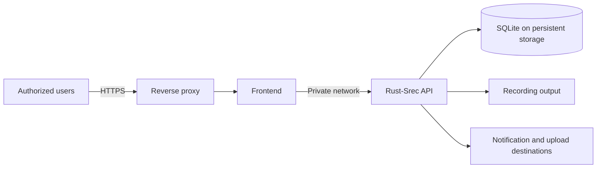

# Production Deployment

Rust-Srec runs as a self-hosted, single-node service. If clustering or failover is a requirement, read [Scope and Limits](./support.md#scope-and-limits) before going further.

## Reference Topology

The topology is the same for both supported deployments; only the private hop between the frontend and the API differs. In Docker it is the Compose network; on a [systemd host](../getting-started/installation.md#systemd-service-linux) it is loopback or a private interface.

Keep the backend, database, configuration, and output paths on one trusted host. Publish only the frontend through a TLS reverse proxy unless an API integration specifically requires direct API access.

## Network Boundary

The frontend reaches the API over `BACKEND_URL=http://rust-srec:8080` on the private Compose network, or over `http://127.0.0.1:12555` when the backend runs as a [systemd service](../getting-started/installation.md#systemd-service-linux) on the same host. Bind host ports to loopback or a private interface (`127.0.0.1:15275:80` / `127.0.0.1:12555:8080` in Compose; `API_BIND_ADDRESS=127.0.0.1` in `/etc/rust-srec/rust-srec.env`) and publish only the frontend behind a TLS reverse proxy (forwarding `Host`, `X-Forwarded-For`, and `X-Forwarded-Proto`; see [Security](./security.md#network-and-session-security) for TLS, cookie, and framing headers).

If direct API access is required, proxy it through HTTPS, restrict source networks, and use individual credentials. Swagger exposes the complete attack surface and should not be public by default.

## Capacity and Reliability

- SQLite, output files, and pipeline work make storage latency material. Put persistent data and recordings on reliable storage sized separately from the system disk; do not use an unreliable network filesystem without testing locking, atomic rename, and sustained write behavior.
- Recording and transcode peaks are different workloads. Set host resource limits and cap `max_concurrent_downloads`, CPU jobs, IO jobs, and uploads independently, starting conservatively and load-testing expected stream counts and bitrates.
- Docker restart policies recover a failed process, but do not provide host failover. Monitor the host as well as the container.
- Keep enough free space for an active recording, temporary pipeline files, and rollback snapshots. See [Storage and Capacity](./storage.md).

## Go-Live Checklist

- **Pinned release**: `VERSION` pinned to a reviewed tag (e.g. `v0.8.0`) for both Docker images, or a recorded release binary for systemd — avoid `latest` where changes require review.
- **Credentials & secrets**: default `admin` password changed, unused accounts disabled, and unique `JWT_SECRET` / `SESSION_SECRET` stored with restrictive permissions (see [Security](./security.md)).
- **Network & TLS**: HTTPS, secure cookies, and private backend/Swagger boundaries verified from the user-facing URL (see [Security](./security.md#network-and-session-security)).
- **Storage & limits**: persistent volume ownership, free-space alerts, and conservative concurrency/resource limits verified.
- **Monitoring & alerts**: liveness and authenticated readiness checks monitored; notifications configured for recording/pipeline failures, credential expiry, and output-root write failures.
- **Recovery & governance**: backup/restore drill and rollback procedure completed; platform recording permission, retention, and privacy requirements approved.

On a [systemd host](../getting-started/installation.md#systemd-service-linux), also verify:

- `systemctl is-enabled rust-srec` returns `enabled` and `/etc/rust-srec/rust-srec.env` (`0640`, `root:rust-srec`) contains `JWT_SECRET`.
- **Settings → Global → Output Folder** and `RUST_SREC_OUTPUT_ROOTS` point to the same writable directory; any external recording volume is listed under `ReadWritePaths=`, exists, and is owned by `rust-srec`.
- `TimeoutStopSec=` exceeds `RUST_SREC_SHUTDOWN_TIMEOUT_SECS` so recordings finalize before `SIGKILL`.

Continue with [Security](./security.md), [Backup and Restore](./backup-restore.md), and [Monitoring](./monitoring.md).
