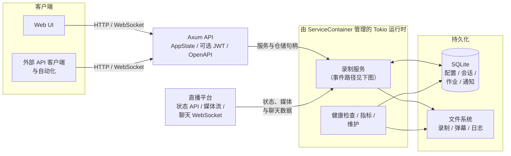
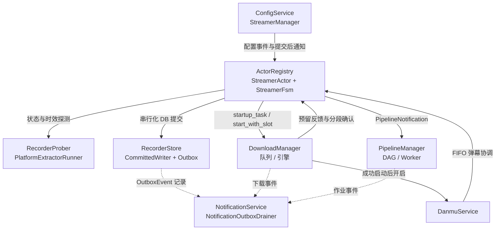
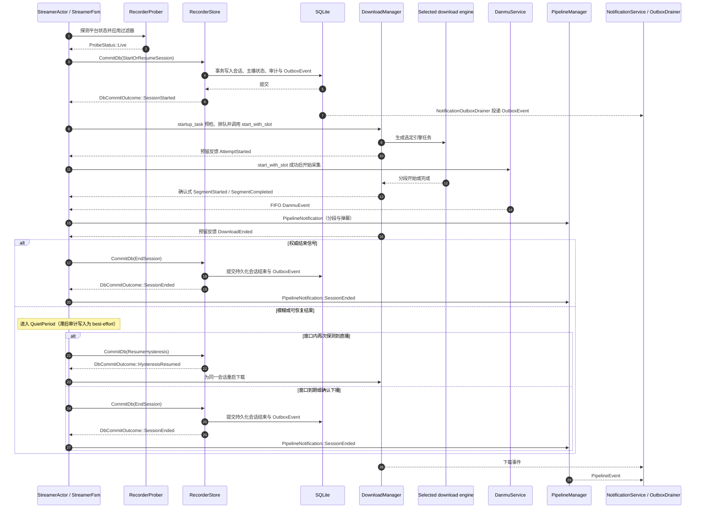
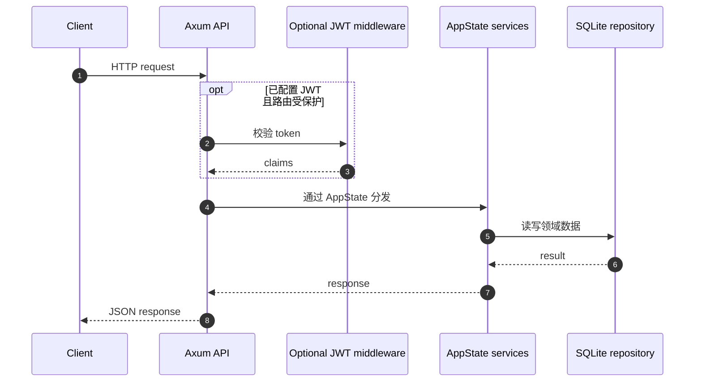

# 运行时架构

面向修改后端服务的贡献者。录制流程和部署边界见[系统概览](../concepts/architecture.md)。

## 高层拓扑 {#高层拓扑}



后端代码按单向依赖 DAG 拆分为内部 workspace crate，由精简的 `rust-srec` 根包组装：

- **Layer 0（`srec-core`、`srec-sqlite`）**：无存储依赖的领域模型、端口契约与工具；SQLite 连接池、`CommittedWriter`、基础模型/仓储与迁移执行器。
- **Layer 1（`srec-engines`、`srec-processors`、`srec-notify`）**：下载引擎（`ffmpeg`、`streamlink`、`mesio`）与弹幕采集器；后处理算子与 BaiduPCS-Go；通知通道、Web Push、后端多语言与 `NotificationOutboxDrainer`。
- **Layer 2（`srec-pipeline`、`srec-recorder`）**：后处理 `PipelineManager` / `DagScheduler` / WorkerPool；录制控制面（`ActorRegistry`、`StreamerActor`、`StreamerFsm`、`RecorderProber`、`RecorderStore`）、`DownloadManager`、`DanmuService`、`ConfigService`、`StreamerManager`、凭据与代理服务。
- **Layer 3（`srec-api`）**：Axum REST/WebSocket 路由、Protobuf、OpenAPI、MCP 服务、认证存储、CQRS 查询、动态日志与健康指标。
- **Layer 4（`rust-srec`）**：`ServiceContainer` 组装、`ConfigBackupPort` 导出/导入、`MaintenanceScheduler`、启动迁移、进程监督，以及面向独立二进制与 `src-tauri` 的 `backend` 门面。

运行时内部，各服务沿以下路径传递控制指令与事件：



运行时服务之间的箭头表示逻辑控制与事件路径。`ServiceContainer` 通过广播订阅、预留反馈许可、确认式协调通道和提交后监听器完成接线，而不是让服务彼此循环耦合。

该拓扑中有三个重要的职责边界：

- `ServiceContainer` 是组合根与事件接线层，并不持有领域状态的所有权。
- `StreamerFsm` 是纯同步状态机，由 `ActorRegistry` 管理的每主播单 `StreamerActor` 驱动；`RecorderProber` 负责状态/时效探测，`RecorderStore` 串行化持久化 SQLite 提交与 `OutboxEvent` 写入。
- 直播提交后会先经由 `startup_task` 与 `StartupLeaseRegistry` 进入下载启动流程；只有 `DownloadManager::start_with_slot` 返回真实下载 ID 后，才会开始弹幕采集。

## 运行时根：`ServiceContainer` {#运行时根-servicecontainer}

`ServiceContainer`（位于 `rust-srec/src/services/container.rs`）负责把所有组件串起来：

- 初始化仓储与服务（数据库、配置缓存、各类 manager/service）
- 启动后台任务（`ActorRegistry`、`NotificationOutboxDrainer`、pipeline workers、维护调度器与 Bigo 开播通知）
- 订阅事件流，并在服务之间转发/协调事件
- 持有用于优雅退出的 `CancellationToken`

这让系统的生命周期与依赖关系有一个统一的“入口点”，方便定位与演进。

## 服务容器职责 {#服务容器职责}

容器组装、有序关闭、输出根目录辅助逻辑和事件决策位于独立的私有模块中。初始化只发现一次输出根目录，并将同一份快照用于健康检查注册和启动写入探测。

启动日志记录数据库与配置 I/O、引擎发现、需要等待的初始化阶段及整体启动的耗时。同步包装对象构造和后台任务启动不单独计时，因为这并不能反映任务随后执行工作的耗时。

## 核心组件（按实际实现） {#核心组件-按实际实现}

### 录制启动与取消（`startup_task` / `StartupLeaseRegistry`） {#录制启动与取消}

下载启动与弹幕初始化通过 `StartupLeaseRegistry`（位于 `srec-recorder/src/recorder/actor/startup_task.rs`）
绑定到触发它们的会话与下载尝试。针对旧会话的下播决策只停止该次尝试，不会按主播 ID 误选后续会话。
禁用、离开时间窗口、凭据退役和删除停止也会取消已登记、但尚未进入下载队列的启动租约。

启动流程在配置读取、预检、排队、时效复查、凭据绑定校验和最终接纳期间响应取消。取消后会释放租约，
且不启动弹幕采集。弹幕采集任务启动后，关闭与退役流程会等待其确认停止，而不是丢弃清理过程。
排队等待时间严格超过时效阈值时，会重新探测 URL、请求头与附加信息；主播缺失或已离线时出队，
临时探测错误则回退到缓存媒体载荷。

### `ConfigService`（配置合并 + 热更新） {#configservice-配置合并-热更新}

`ConfigService` 是配置控制面，负责加载并合并四层配置：

1. 全局默认（Global）
2. 平台配置（Platform）
3. 模板配置（Template）
4. 主播覆盖（Streamer overrides）

它会缓存合并后的结果，并广播 `ConfigUpdateEvent`，让运行时服务可以无重启响应配置变更。

各层的代理连接方式会与其他设置一起解析为 `MergedConfig.proxy_route`，供检查、下载、弹幕和服务器代理播放共用；
已保存的代理本身通过 `ProxyService` 写入。参见[代理连接](./configuration.md#proxy-routes)。

参见：[配置](../concepts/configuration.md)

### `StreamerManager`（已提交的元数据快照） {#streamermanager-已提交的元数据快照}

SQLite 行是权威数据。`StreamerManager` 为 actor 检查提供不可变的共享元数据快照，
为管理操作保留克隆值接口。运行时写入共享 `CommittedStreamerState`：经过校验的
单写连接会持续持有到借用的立即事务提交，以及同步元数据/URL 索引发布完成。
等待运行时副作用时不占用该数据库连接。

提交开始前取消会回滚已准备的变更；进入提交后，即使请求任务消失，受监督的完成
任务也会发布已提交快照。状态、会话和 outbox 仍原子更新；`RETURNING` 提供主播行，
不再在提交后重新查询。发布时保留当前仅存在于运行时的下播检查配置。管理补丁读取
数据库当前行，保留无关凭据和计数器；失败的 URL 修改不会改变任何缓存索引。合并配置
的失效与在途解析完成共享短临界区，较早的加载不会在新提交使缓存失效后重新放回旧凭据。

导入在提交时静默发布行快照并使过滤器快照失效，然后释放写连接，由同一任务所有者
按顺序完成凭据、退役、元数据、通道和全局通知。一个导入准入许可限制这些运行时
工作数量；提交后的重载失败仍作为已提交变更的警告返回。

一个重要的正确性细节：启动时会执行 **重启恢复**，把数据库中遗留的 `Live` 状态重置为
`NotLive`，确保 `NotLive → Live` 这条边能够再次触发下载启动。
即使前后状态均为 `NotLive`，actor 也会处理首次确认的下播结果，结束数据库中遗留的未完成
会话并发布最终完成事件。处理失败或被抑制时会等待后续检查重试。开播结果会复用未完成
会话，保留重启前后的录制连续性。

### `ActorRegistry` 与 `StreamerActor`（控制面编排） {#录制控制面}

`ActorRegistry`（位于 `srec-recorder/src/recorder/registry.rs`）负责监督常驻的每主播 Actor：

- `StreamerActor`：每个活跃主播拥有一个非阻塞的 `tokio::select!` 事件循环，驱动 `StreamerFsm`，并发轮询邮箱、最多一个在途 `CommitDb` Future、最多一个在途 `Probe` Future、可选的批量预检开播提示、最早的 FSM 定时期限以及副作用任务。
- `ActorRegistry`：响应 `PostPublicationListener` 批次与 `ConfigUpdateEvent` 对齐活跃主播、维护 Actor 世代号与单调配置修订号、桥接下载与弹幕确认式协调通道、执行 4-owner 物理退役校验（`retire_streamer` / `retire_and_reap`），并监督异常退出的 Actor。

在创建 Actor 或推送更新配置前，`ActorRegistry` 会通过 `ConfigService` 解析全局 → 平台 → 模板 → 主播四层配置，
并在等待异步解析前预先分配单调递增的配置修订号，避免较慢的查询覆盖较新的更新。
解析失败时，运行中的 Actor 保留上一次成功解析的配置，也不会创建新 Actor，并按指数退避（基础 5 秒、上限 5 分钟）重试。
配置更新本身不会触发立即检查，只有凭据、过滤器和清除错误事件才会请求检查。周期检查在配置间隔的 ±10% 范围内随机分散；
有效间隔未变时保留原定检查时间，变化时可提前检查但不推迟已安排的期限。智能唤醒、准入/冷却期限、显式立即检查与在线 watchdog 保留各自时序约束。

预期内的终止退出（`Disabled`、`FatalError`、`Retired`、`Shutdown`）会清理凭据阻断记录并正常退出，不会自动重启。
当 Actor 任务 panic 时，`ActorRegistry` 按指数退避（基础 2 秒、上限 60 秒）最多自动重启 `MAX_CRASH_RESTARTS`（5）次；正常退出会清零崩溃计数。

### `RecorderProber` 与 `RecorderStore`（探测、持久化与 Outbox） {#探测与持久化存储}

- **`RecorderProber`**（位于 `srec-recorder/src/recorder/prober.rs`）封装共享的 `PlatformExtractorRunner`（复用的 HTTP 连接池与代理/隧道 `ExtractorFactory`），按 `CredentialCheckKey` 对在途探测去重，执行批量预检与 Bigo 开播通知门控，跟踪凭据阻断状态，通过 CAS 持久化平台元数据，并异步记录检查历史。
- **`RecorderStore`**（位于 `srec-recorder/src/recorder/store.rs`）在每主播串行化租约与 `CommittedWriter`（`committed_write_supervisor`）保护下执行所有 `DbCommitOp`（`StartOrResumeSession`、`ResumeHysteresis`、`EndSession`、`RecordFatalError`、`RecordTransientError`、`SetInfraBlocked` 等）。已封存的提交即使在 Actor 停止或被丢弃后仍会完成，并同步发布到 `StreamerCache`、释放 SQLite 写连接与主播租约，随后再唤醒 `NotificationOutboxDrainer` 并通知 `PostPublicationListener`。

**Outbox 模式**：面向用户的通知记录（`srec-core` 中的 `OutboxEvent`）与状态/会话更新在同一 SQLite 事务中写入 `monitor_event_outbox`。
`NotificationOutboxDrainer`（位于 `srec-notify`）按 `id` 升序扫描未投递行，同时兼容解析当前 `OutboxEvent` 与升级遗留的 `LegacyOutboxEvent`，仅在 `NotificationService::deliver_durable_for_outbox` 完成投递后才标记 `delivered_at`。

### `StreamerFsm`（会话与监控状态的唯一所有者） {#streamerfsm-状态机}

`StreamerFsm`（位于 `srec-recorder/src/recorder/fsm.rs`）是纯同步状态机，独占单个主播的轮询调度、离线确认、静默期滞后（quiet-period hysteresis）、终止原因分类、凭据诊断恢复与停止协调逻辑。

新建会话（`CommittingStart`）和持久化结束都会先通过 `RecorderStore` 提交 SQLite 变更，再启动下载或发出 `PipelineNotification::SessionEnded`。
进入静默期时保留 SQLite 会话开启（`end_time IS NULL`）并 best-effort 写入滞后审计记录；窗口内再次探测到开播会提交 `ResumeHysteresis` 并复用同一会话重启录制，窗口到期或确认下播则提交 `EndSession`。
若静默期到期提交遇到临时 SQLite 错误，FSM 会保留打开的会话并在 1 秒后重试。优雅关闭会排空在途提交与 Actor；强制关闭遵守硬期限，同时不中止已封存的 `COMMIT`。

### `DownloadManager`（下载调度 + 引擎抽象） {#downloadmanager-下载调度-引擎抽象}

DownloadManager 负责：

- 并发控制（含高优先级额外并发槽位）
- 失败分类与熔断器（按引擎类型、配置以及可选的主播范围隔离）
- 失败/拒绝事件与 retry-after 提示；由 `StreamerFsm` 决定何时重新探测并再次进入下载启动流程
- 引擎抽象：
  - 外部进程：`ffmpeg`、`streamlink`
  - 内置 Rust 引擎：`mesio`

并通过 `DownloadManagerEvent` 广播下载生命周期与分段事件。

对于落库后的 session 分段，后端会保留三种不同含义的时间戳：

- `created_at`：该分段开始录制的时间
- `completed_at`：该分段结束录制的时间
- `persisted_at`：该分段元数据写入 SQLite 的时间

### `DanmuService`（弹幕/聊天采集） {#danmuservice-弹幕-聊天采集}

弹幕采集以 session 为单位维持连接，以 segment 为单位落盘：

- session 期间维持 websocket 连接与统计（可选）
- 由下载分段边界驱动，开启/结束对应的弹幕文件（如 XML）
- Danmu 事件会转发到 pipeline，用于“视频+弹幕配对”等协调逻辑

### `PipelineManager`（队列 + DAG + WorkerPool） {#pipelinemanager-队列-dag-workerpool}

PipelineManager 是后处理引擎：

- DB-backed job queue（支持重启恢复）
- DAG 执行（fan-in / fan-out、fail-fast）
- CPU、IO 与上传分离的 worker pool；上传 pool 的大小由**最大上传数**决定，BaiduPCS 上传在其中同一时间最多运行一个
- 多阶段触发协调：
  - Segment pipeline（单个文件）
  - Paired-segment pipeline（同一分段的 视频 + 弹幕）
  - Session-complete pipeline（会话结束后、所有分段完成后触发）

参见：[DAG 管道](../concepts/pipeline.md)

### `NotificationService`（事件分发） {#notificationservice-事件分发}

NotificationService 订阅监控/下载/会话/管道事件，并分发到 Discord / Email / Gotify /
Telegram / Webhook 通道，包含重试、熔断与 dead-letter 持久化。可选的浏览器 Web Push
由 `WebPushService` 处理。

参见：[通知](../concepts/notifications.md)

### 仓库行写入 {#仓库行写入}

完整作业、DAG、步骤、会话、媒体输出和分段写入，在已有 SQLite 连接上复用仓库负责的
列绑定。重试、时钟和事务仍由调用方拥有。DAG 发布先插入未关联作业的步骤，再在同一
事务中关联根作业；后续物化仍使用独立的活跃父 DAG 和 PENDING/BLOCKED 条件。

原始会话创建保留传入模型，生命周期创建则构建带初始标题的活跃会话。原始结束操作仍
无条件更新，生命周期结束只修改活跃行。媒体插入与会话大小记账共同提交，组合分段创建
也加入该事务；单独插入分段不增加会话总大小。保留存储的毫秒值、可空生命周期时间戳和
未显式指定的数据库默认值。

## 下载器 Rust 接口 {#下载器-rust-接口}

下载管理器将事件契约放在 `downloader::manager::events`，确认式事件传递放在 `coordination`，引擎配置放在 `configuration`，下载任务生命周期放在 `attempt`。这些实现模块保持私有；通过 `downloader` 导入现有事件的公开路径以及通过 `downloader::manager` 导入的内部路径保持不变。运行时关闭使用 `DownloadManager::shutdown_until`，活动下载条目持有队列槽位，直到条目被移除。

Rust 集成应使用受支持的管理器关闭与快照方法、`DownloadConfig::build_pipeline_config`，以及公开的 `CircuitBreaker` 方法。内部熔断器管理通过 `CircuitBreakerManager::get` 获取实例。Mesio 引擎诊断报告所链接库的 `mesio::VERSION`。

### FFmpeg 录制事件 {#ffmpeg-录制事件}

直接 FFmpeg 录制与 Streamlink 重封装共享分片标识、时长与字节累计、进度采样、
输出错误分类及最终事件发布。文件系统字节缓存只属于当前分片：切换分片后，
在新分片的元数据采样成功前使用解析出的进度字节数。每个活动分片的文件系统
采样仍以 500 毫秒为间隔节流。

标准错误 EOF 不代表最终文件已经关闭。跟踪器等待进程所有者报告退出结果后，
才检查并发布最终分片；无法确认清理完成时不发布该分片完成事件。输出 I/O 错误
仍先于终止失败事件发布；仅当标准错误尚未识别输出错误时，退出码 228 才提供
磁盘已满的回退分类。

辅助任务收尾会跨超时保留已完成的等待结果，在无法确认清理时中止并等待未完成
任务，确认清理成功后则允许最终事件正常发布。FFmpeg 的标准输入停止命令与
Streamlink 的生产者、管道和受控子进程关闭策略仍分别保留。Streamlink 在本次录制
剩余的进程预算内获得有上限的退出等待，之后进入受控终止；详见
[停止 Streamlink 录制](../concepts/engines.md#停止-streamlink-录制)。

## 关键流程 {#关键流程}

### 录制生命周期（端到端） {#录制生命周期-端到端}



### API 请求流（控制面） {#api-请求流-控制面}



受保护路由使用 JWT 中间件；通过 `AUTH_DISABLED` 关闭鉴权时，所有路由均无需鉴权。完整健康检查与
就绪检查会在处理器内部校验 bearer token；liveness 与 idle 检查保持公开。WebSocket、
媒体与流代理路由使用各自文档中说明的查询参数鉴权路径。

## 录制器状态与退避 {#调度器状态与退避}

主播 Actor 将调度状态保存在 `StreamerFsm` 中，并从 `StreamerManager` 的数据库元数据缓存读取不可变快照。运行时恢复依赖 SQLite 中的会话与主播状态，无需 Actor 状态文件。

监控通过 `RecorderStore` 的事务式错误写入与 `disabled_until_for_error_count` 计算退避。退避保留配置的阈值，从 60 秒开始翻倍，最多一小时；即使存储的错误计数很大，也会安全达到上限，不会溢出。数据库与缓存发布共享上述 `CommittedWriter` 边界。

### 可靠的生命周期反馈 {#可靠的生命周期反馈}

录制启动与终止反馈使用预留容量通道（`ActorRegistry::download_feedback` 实现的 `RecorderDownloadFeedback`），与进度广播及分段确认通道分离。`ServiceContainer` 在构造阶段通过 `DownloadManager::set_recorder_feedback` 接入该通道。每次被接纳的尝试在启动前预先保留 `AttemptStarted` 与 `DownloadEnded` 容量；接纳不会等待 Actor 消费邮箱，终止反馈严格在下载槽位释放后发布。Actor 世代号与尝试 ID 用于隔离延迟消息。

每个主播最多保留 32 个生命周期许可。全局预算为 1,024 个积压许可，加上运行期间最高录制总并发数的两倍（含高优先级额外槽位）。提高并发时扩容，降低时保留已持有的预留容量。容量不足会返回可重试的 `RecorderFeedbackBusy` 错误（HTTP 错误码 `SCHEDULER_FEEDBACK_BUSY`），并通知 `ActorRegistry::request_retry_admission`，不会将主播标记为离线或禁用。

配置解析在等待 `ConfigService` 之前先分配单调递增的修订号，避免较慢查询覆盖较新配置，且配置广播丢失时会触发全量重对齐。进度广播保持节流且允许丢失。关闭流程先停止监控，再排空录制；即使 Actor 已经退出，尾随关闭的分段仍会经由 `ActorRegistry` 的会话级回退路径完成持久化。

## 事件驱动通信 {#事件驱动通信}

跨服务协调按投递语义使用不同通道：

| 事件流 / 通道 | 发布者 | 典型消费者 | 备注 |
|---|---|---|---|
| `ConfigUpdateEvent` | `ConfigService`、`StreamerManager` | `ActorRegistry`、`ServiceContainer` | 驱动 Actor 重对齐、运行时重配置与资源清理 |
| `PostPublicationChangeSet` | `CommittedStreamerState`、`RecorderStore` | `ActorRegistry` | 严格在 `COMMIT` 与锁释放后触发 Actor 重对齐 |
| `OutboxEvent`（SQLite Outbox） | `RecorderStore` | `NotificationOutboxDrainer` → `NotificationService` | 与状态/会话提交同事务落库，跨重启可靠投递 |
| `DownloadManagerEvent` | `DownloadManager` | `ActorRegistry`（预留反馈 + 分段确认 + 进度）、`NotificationService` | `Started`/终止走预留许可，分段走确认式协调通道 |
| `DanmuEvent` | `DanmuService` | `ActorRegistry`（FIFO 协调） | 按序投递给 Actor（含退出后回退）并转发至 `PipelineManager` |
| `PipelineNotification` | `StreamerActor` / `ActorRegistry` | `PipelineManager`（经 `RecorderPipelinePort`） | 驱动分段、配对分段与会话完成 DAG |
| `PipelineEvent` | `PipelineManager` | `NotificationService` | 作业生命周期与可观测性 |

::: tip 关于限流/节流
`PipelineManager` 内置可选的节流系统（`ThrottleController`）。若注入
`DownloadLimitAdjuster`，可以根据队列压力动态调节下载并发。
:::

### 输出根写入门 {#输出根写入门}

下载管理器内置了一个**输出根写入门**（`downloader::output_root_gate`），它工作在文件系统边界上，作为运行在网络/进程边界上的引擎熔断器（circuit breaker）的互补机制。设计目标是：当文件系统出现单点故障（磁盘写满、绑定挂载失效、权限丢失）时，不让这次故障级联成数十次每主播的重试，淹没日志和数据库 outbox。

```
Healthy ──(record_failure：启动前 ENOENT / 运行时 ENOSPC / 启动探测)──► Degraded
                                                                         │
                            (mark_healthy：下一次真实 ensure_output_dir 成功)│
Healthy ◄────────────────────────────────────────────────────────────────┘
```

关键特性：

- **无锁热路径**。在 Healthy 状态下，`check()` 只做一次原子加载加一次 `DashMap::get`，没有互斥锁，也没有空跑成本。
- **基于 CAS 的单飞冷却**。当根处于 `Degraded` 时，每个冷却窗口（默认 30 秒）只允许一个调用方通过，去尝试真实的 `create_dir_all`；其他并发调用方以缓存的错误快速拒绝。这借鉴了 `CircuitBreaker` 的 half-open 模式。
- **没有后台探测任务**。真实的 `ensure_output_dir` 调用本身就是探测——写入门复用实际的下载尝试作为探测信号。容器启动时会运行一次有界的一次性探测，以便在录制开始前发现失效的挂载点。
- **恢复钩子**。在 `Degraded → Healthy` 的切换时，写入门会清除所有因它而退避的主播的 `consecutive_error_count`、`disabled_until` 和 `last_error`（通过 `"output-root blocked:"` 前缀过滤）。所有受影响的主播会在这次状态切换时解除退避。
- **每次状态切换只发出一条通知**。`Healthy → Degraded` 的 CAS 同时也是决定"哪个调用方负责发出 critical 级 `output_path_inaccessible` 通知"的位置——无论有多少并发主播受影响，用户只会看到一条告警。
- **只有 `ENOSPC` 会在录制途中进入写入门**。写入器写满磁盘时，会在录制仍在进行的过程中把故障上报给写入门，使该根降级，从而对下一次启动进行限流。其他写入失败——文件系统只读、权限丢失、路径消失——会被归类为文件级故障，仍由引擎的 `CircuitBreaker` 处理；它们通过启动探测抵达写入门，只有在同时导致启动前钩子的 `create_dir_all` 失败时才会经由该钩子抵达。目录已存在但不可写时 `ensure_output_dir` 返回 `Ok`，因此启动前钩子发现不了这种情况。之所以这样划分，是因为 `OutputRootUnavailable` 不计入熔断器，对这一类故障来说写入门是唯一的限流手段。

写入门在 `/api/health` 中以一个聚合的 `output-root` 组件暴露，列出所有 Degraded 根及其分类后的 `io::ErrorKind`、被拒绝次数和上次尝试的时间。参见[通知系统文档](../concepts/notifications.md#存储严重事件)了解事件形态，以及 [Docker 故障排查](../getting-started/docker.md#清理存储)了解挂载失效的失败模式。

## 服务所有权 {#服务所有权}

`StreamerFsm` 在内存中保留有界的 60 秒 `RecentlyEnded` 窗口用于重新归因延迟的定时结束；该窗口由 Actor 的常规期限定时器清理，并在 Actor 退出时直接释放。`AppState` 复用容器中的仓库实例、`ActorRegistry` 与 `ConfigBackupPort` 实现，而日志归档授权及归档容量控制仍属于各自的 API 状态。

## 可观测性、健康检查与优雅退出 {#可观测性、健康检查与优雅退出}

- 日志：使用 `tracing`，支持动态调整过滤器并带日志保留清理
- 健康检查：
  - `GET /api/health/live`（无鉴权，适合作为容器 liveness）
  - `GET /api/health/idle`（无鉴权；报告是否有录制或流水线任务正在运行，供 Watchtower 更新钩子使用）
  - `GET /api/health` 与 `GET /api/health/ready` 需要有效 bearer token，关闭鉴权时除外
### 独立后端关闭期限 {#独立后端关闭期限}

- 独立后端把 SQLite、套接字和录制文件都限制在操作系统隔离的工作进程中。父进程的专用线程观测 `SIGINT`（所有支持平台）和 `SIGTERM`（Unix），即使启动准入、异步运行时工作或标记 I/O 阻塞也会立即启用绝对关闭期限。看门狗会持续运行，直到持久化标记更新、终止诊断和父进程退出全部完成。
- 父进程和工作进程都注册了信号处理，因此像 `KillMode=control-group` 或 `pkill` 那样直接打到工作进程的信号，与经由控制管道转发的信号走同一条 `ServiceContainer` 分阶段优雅收尾流程，在最终分段事实持久化之前保持必需的事件消费者运行。
- 工作进程自身的收尾预算由 `RUST_SREC_SHUTDOWN_TIMEOUT_SECS` 减去 `RUST_SREC_SHUTDOWN_FORCE_RESERVE_SECS`（再留出少量调度余量）推导，因此调大超时会实际延长录制收尾阶段。录制引擎会把自身的优雅停止等待时间限制在该预算的剩余部分内，避免单个引擎更长的停止超时导致子进程在收尾中被强制结束。
- 进入强制预留阶段时，如果运行时仍在活动，父进程会终止受控进程树并以失败状态退出（`124` 表示达到硬期限；`125` 表示进程树终止请求本身失败）。工作进程内部发生致命故障时会直接失败退出，不会进入无期限的优雅关闭，由父进程终止后代并保留恢复状态。若关闭超出宽限期但仍完成了全部收尾，进程仍按正常退出处理；只有无法收束的工作才会被记为崩溃。
- 被强制终止或崩溃的工作进程会在 SQLite 旁保留未清理运行世代标记，只保留最早和最新的未清理世代以及中间世代数量，防止重启循环使其无限增长。更早的恢复事项不会被之后正常退出的运行世代清除；该标记只负责检测而不负责重放文件，仅应在后端停止且中断文件核对完成后删除。

## 后端 Rust 接口 {#后端-rust-接口}

主播状态的统一类型为 `rust_srec::domain::StreamerState`，包含 `ERROR` 和 `DISABLED`。数据库模型构造函数与 API 状态转换检查均使用此类型。`StreamerState::can_transition_to` 保留为状态转换校验入口；录制状态和错误退避由运行时服务持久化，不通过修改配置层的 `domain::Streamer` 实体来驱动。

会话和媒体数据使用 `database::models` 中的持久化模型；磁盘状态分类使用 `HealthChecker::check_disk_space_with_thresholds`。主播仓库保留 `list_streamers`（排除已标记删除的记录）和 `list_all_streamers`（包含这些记录，以便启动时完成退出与清理）。

工作流状态转换统一由 `pipeline::DagScheduler` 决定：Worker 通过 `on_job_attempt_completed` 或 `on_job_attempt_failed` 上报任务结果，由调度器决定该次尝试是重试、失败还是忽略；管理器通过 `retry_dag` 重试工作流，校验、重置、重启和回放都在这一个入口内完成。`DagRepository` 继续持有让每次转换持久化的受保护的事务，并提供 `list_ready_steps` 作为与完成事务共用的唯一就绪规则。

### Actor 终止与唤醒策略 {#actor-终止与唤醒策略}

`StreamerFsm` 将探测处理、下载尝试、提交对账、凭据恢复、滞后窗口、调度计算、分段跟踪与停止协调拆分到
`srec-recorder/src/recorder/fsm/` 下的独立子模块。只有权威的下播信号（`StreamerOffline` 或 HLS `#EXT-X-ENDLIST`）
会立即结束会话；干净断连和可恢复停止会进入静默期以吸收重连，应用关闭和禁用则暂停轮询（`Shutdown` 保留数据库会话供重启恢复，
`Disable` 与 `Retire` 则关闭会话）。

显式检查期限优先于在线 watchdog。在线 Actor 的 watchdog、5 分钟停滞窗口或时间窗口边界唤醒中最早的一个，
会受 60 秒失败 watchdog 最小重试间隔下界约束。周期轮询保留 ±10% 抖动；智能唤醒、准入与立即检查期限继续保有各自约束。

`StreamerActor` 与 `ActorRegistry` 从 `StreamerManager` 读取不可变的 `Arc<StreamerMetadata>` 快照并通过 `ConfigService` 解析合并配置，
`RecorderProber` 统一负责去重后的状态与时效探测。

<div id="runtimecoordinator-录制启动与取消" class="legacy-section">

此节内容已移至[录制启动与取消](#录制启动与取消)。

</div>

<div id="scheduler-actor-模型编排-调度" class="legacy-section">

此节内容已移至[ActorRegistry 与 StreamerActor](#录制控制面)。

</div>

<div id="streammonitor-探测-过滤-outbox" class="legacy-section">

此节内容已移至[RecorderProber 与 RecorderStore](#探测与持久化存储)。

</div>

<div id="sessionlifecycle-会话状态的唯一所有者" class="legacy-section">

此节内容已移至[StreamerFsm](#streamerfsm-状态机)。

</div>
