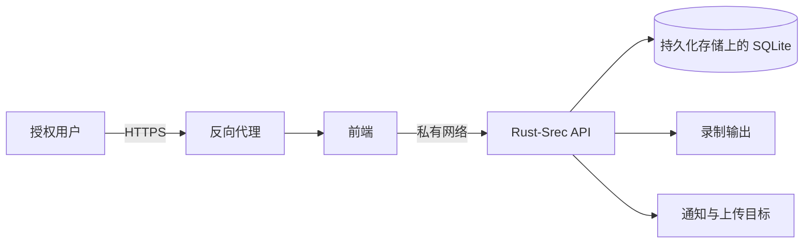

# 生产部署

Rust-Srec 以自托管单节点服务运行。如果必须具备集群或故障转移能力，请先阅读[能力边界](./support.md#能力边界)。

## 参考拓扑

两种部署方式的拓扑相同，只有前端到 API 这一段私有链路不同：Docker 中是 Compose 网络，[systemd 主机](../getting-started/installation.md#systemd-服务-linux)上则是回环地址或私有网卡。

后端、数据库、配置和输出路径应位于同一受信任主机。除非 API 集成确有需要，否则只通过 TLS 反向代理发布前端。

## 网络边界

前端通过私有 Compose 网络中的 `BACKEND_URL=http://rust-srec:8080` 访问 API；后端以 [systemd 服务](../getting-started/installation.md#systemd-服务-linux)运行在同一主机时，则通过 `http://127.0.0.1:12555` 访问。将宿主机端口绑定到回环或私网地址（Compose 使用 `127.0.0.1:15275:80` 和 `127.0.0.1:12555:8080`；systemd 在 `/etc/rust-srec/rust-srec.env` 中设置 `API_BIND_ADDRESS=127.0.0.1`），并仅通过 TLS 反向代理发布前端（转发 `Host`、`X-Forwarded-For` 与 `X-Forwarded-Proto`；TLS、安全 Cookie 与页面嵌入头配置见[网络与会话安全](./security.md#网络与会话安全)）。

必须直接访问 API 时，应通过 HTTPS 代理、限制来源网络并使用独立凭据。Swagger 会展示完整攻击面，默认不应公开。

## 容量与可靠性

- SQLite、输出文件和管道处理都受存储延迟影响。将持久化数据与录制目录放在独立于系统盘的可靠存储上；未验证锁、原子重命名和持续写入行为前，不要采用不可靠的网络文件系统。
- 录制峰值和转码峰值是不同工作负载，应设置主机资源限制并分别限制下载、CPU 任务、IO 任务和上传并发数，从保守值开始按预计同时录制数和码率压测。
- Docker 重启策略只能恢复进程，不能提供主机级故障转移；主机本身也必须监控。
- 空闲空间要覆盖活跃录制、管道临时文件和回滚快照。参见[存储与容量](./storage.md)。

## 上线检查清单

- **固定版本**：Docker 将两个镜像的 `VERSION` 固定为已审查的标签（如 `v0.8.0`），systemd 安装正式发布二进制并记录版本——变更需审批的环境不要使用 `latest`。
- **凭据与密钥**：已修改默认 `admin` 密码、禁用不用的账号，并妥善限制唯一的 `JWT_SECRET` 和 `SESSION_SECRET` 权限（见[安全](./security.md)）。
- **网络与 TLS**：已从用户访问地址验证 HTTPS、安全 Cookie，以及后端与 Swagger 的私网边界（见[网络与会话安全](./security.md#网络与会话安全)）。
- **存储与限额**：已验证持久化卷所有权、磁盘空间告警以及保守的并发与资源限制。
- **监控与告警**：已监控存活检查和带认证的就绪检查，并为录制/管道失败、凭据过期和输出根不可写配置通知。
- **恢复与治理**：已完成备份恢复演练和回滚流程，并确认平台录制授权、保留周期和隐私要求。

[systemd 主机](../getting-started/installation.md#systemd-服务-linux)还需确认：

- `systemctl is-enabled rust-srec` 返回 `enabled`，且 `/etc/rust-srec/rust-srec.env`（`0640`、`root:rust-srec`）包含 `JWT_SECRET`。
- **设置 → 全局 → 输出文件夹**与 `RUST_SREC_OUTPUT_ROOTS` 指向同一可写目录；外部录制卷已写入 `ReadWritePaths=`、已存在且属主为 `rust-srec`。
- `TimeoutStopSec=` 大于 `RUST_SREC_SHUTDOWN_TIMEOUT_SECS`，录制能在 `SIGKILL` 之前收尾。

继续阅读[安全](./security.md)、[备份与恢复](./backup-restore.md)和[监控](./monitoring.md)。
